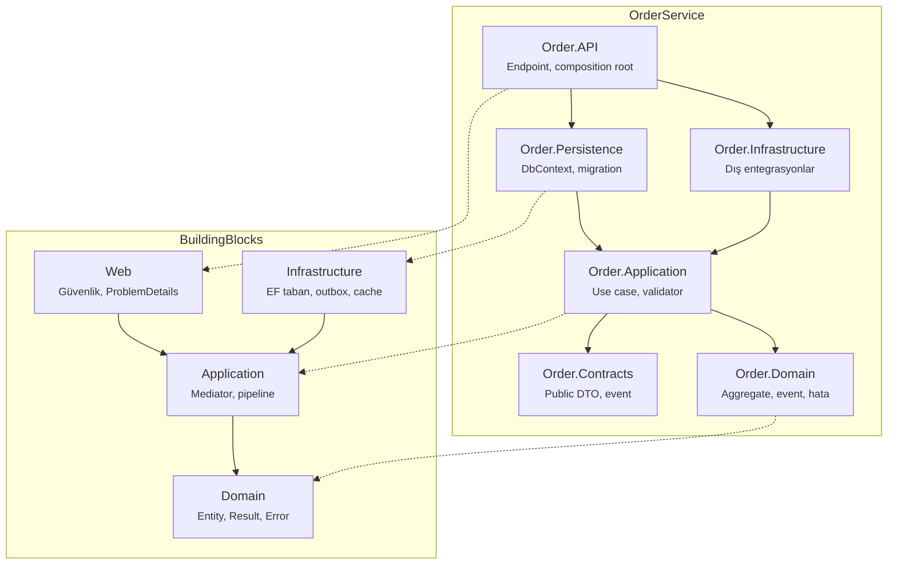
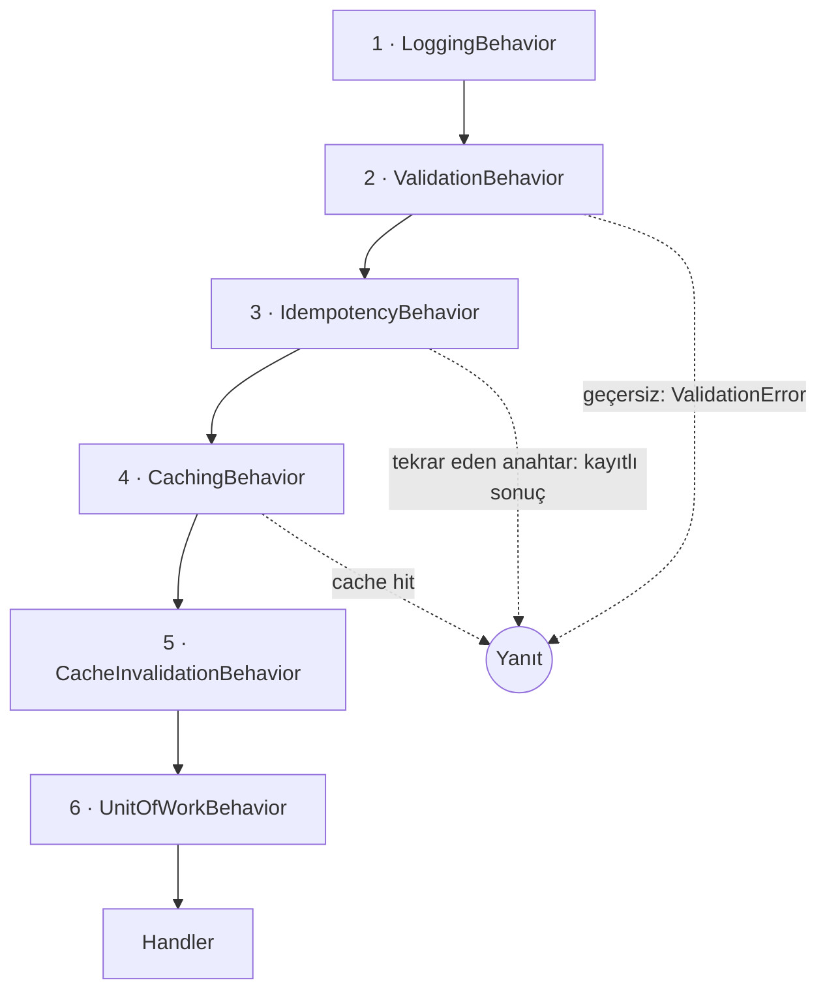
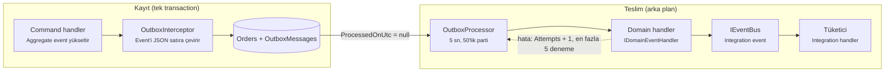

# Onion Template

Onion Template, tek komutla (`dotnet new onion -n Order`) üretime hazır bir .NET 10 mikroservisi üreten bir
`dotnet new` şablonudur. Varsayılan çıktıda hiçbir üçüncü parti NuGet paketi yoktur; mediator, validation,
result pattern, outbox ve izin tabanlı yetkilendirme şablonun içinde yazılmıştır.

Bu doküman şablonu kullanan ve geliştiren yazılımcılar içindir. Örnekler `-n Order` ile üretilmiş bir servis
üzerindendir; şablon kaynağında aynı yerlerde `ServiceName` yazar.

## İçindekiler

1. [Genel bakış](#1-genel-bakış)
2. [Kurulum ve kullanım](#2-kurulum-ve-kullanım)
3. [Çözüm yapısı ve katman kuralları](#3-çözüm-yapısı-ve-katman-kuralları)
4. [Domain katmanı](#4-domain-katmanı)
5. [Mediator ve CQRS](#5-mediator-ve-cqrs)
6. [Validation](#6-validation)
7. [Persistence](#7-persistence)
8. [Caching, idempotency ve mesajlaşma](#8-caching-idempotency-ve-mesajlaşma)
9. [Web katmanı ve güvenlik](#9-web-katmanı-ve-güvenlik)
10. [Gözlemlenebilirlik](#10-gözlemlenebilirlik)
11. [Yapılandırma referansı](#11-yapılandırma-referansı)
12. [Test stratejisi](#12-test-stratejisi)
13. [Build, Docker ve CI/CD](#13-build-docker-ve-cicd)
14. [Geliştirici rehberi](#14-geliştirici-rehberi)
15. [Bilinen sınırlar ve yol haritası](#15-bilinen-sınırlar-ve-yol-haritası)
16. [Şablon üzerinde geliştirme](#16-şablon-üzerinde-geliştirme)

---

## 1. Genel bakış

### Tasarım ilkeleri

- **Sıfır üçüncü parti bağımlılık:** yalnızca BCL ve Microsoft'un kendi paketleri. MediatR'ın ticari lisansa
  geçmesi gibi lisans ve tedarik zinciri risklerini ortadan kaldırır.
- **Bağımlılıklar içe doğru:** Domain hiçbir şeye, Application yalnızca Domain'e bağlıdır. Kural mimari
  testlerle derleme sırasında zorlanır.
- **Varsayılan olarak güvenli:** her endpoint kimlik doğrulama ister; açık olması gereken uçlar (health,
  OpenAPI) bunu açıkça belirtir.
- **Akış kontrolü için exception yok:** iş kuralı hataları tipli `Error` olarak döner ve HTTP katmanında
  ProblemDetails'e çevrilir.
- **Hızlı başarısız ol:** DI kayıtları (`ValidateOnBuild`) ve options (`ValidateOnStart`) uygulama açılırken
  doğrulanır.
- **Uyarı = hata:** .NET analyzer'ları `Recommended` modda çalışır, `TreatWarningsAsErrors` açıktır.

### Teknoloji yığını

| Alan | Kullanılan | Sürüm |
| --- | --- | --- |
| Çalışma zamanı | .NET / ASP.NET Core Minimal API | 10.0 |
| ORM | Entity Framework Core | 10.0.13 |
| Veritabanı | SQL Server (varsayılan), PostgreSQL (Npgsql 10.0.3), SQLite | — |
| Cache | Microsoft.Extensions.Caching.Hybrid | 10.11.0 |
| Kimlik doğrulama | Microsoft.AspNetCore.Authentication.JwtBearer | 10.0.13 |
| API dokümanı | Microsoft.AspNetCore.OpenApi (OpenAPI 3.1) | 10.0.13 |
| Test | MSTest + Microsoft.Testing.Platform, Mvc.Testing | 4.5.1 |
| Opsiyonel | OpenTelemetry (`--otel`) | 1.20.0 |
| Konteyner | `aspnet:10.0-noble-chiseled-extra` | — |

## 2. Kurulum ve kullanım

### Kurulum

```bash
# Geliştirme sırasında klasörden (değişiklikler anında yansır)
dotnet new install ./templates/onion

# Dağıtım için NuGet paketi
dotnet pack Onion.Templates.csproj -o artifacts
dotnet new install artifacts/GokhanErtogan.OnionTemplate.1.0.0.nupkg
```

### Parametreler

| Parametre | Kısa | Varsayılan | Açıklama |
| --- | --- | --- | --- |
| `-n` | — | `Sample` | Servis adı. Proje, namespace, sınıf, route, izin ve cache anahtarlarına yansır |
| `--database` | `-db` | `sqlserver` | `sqlserver`, `postgres` veya `sqlite` |
| `--service-only` | — | `false` | Yalnızca `src/Services/<Ad>Service` üretir ve projeleri mevcut solution'a ekler |
| `--solution-name` | `-sn` | servis adı | Solution dosyasının adı (`<ad>.slnx`) |
| `--otel` | — | `false` | OpenTelemetry trace/metric/log ekler |
| `--no-restore` | — | `false` | Oluşturma sonrası restore'u atlar |

Her üretimde HTTP/HTTPS portları (5100–5999 ve 7100–7999 aralığında) ve API'nin `UserSecretsId` değeri
yeniden üretilir. Böylece aynı makinede birden çok servis çakışmadan çalışır.

### İsim dönüşümleri

| Şablondaki ifade | Biçim | `-n Order` sonucu | Nerede |
| --- | --- | --- | --- |
| `ServiceName` | Olduğu gibi | `Order` | Klasör, proje, namespace, sınıf |
| `servicename` | Küçük harf | `order` | Docker servis ve veritabanı adları |
| `service-name` | Kebab case | `order` | Route (`/api/v1/orders`), izin (`orders:write`), cache anahtarı |
| `serviceName` | İlk harf küçük | `order` | Değişken adları |
| `SolutionName` | `--solution-name` ya da ad | `Order` | Solution dosyası, README başlığı |

Çok kelimeli adlarda kebab biçimi kelimeleri ayırır: `-n OrderManagement` → `/api/v1/order-managements`.

### Senaryolar

```bash
dotnet new onion -n Order                                # SQL Server
dotnet new onion -n Order --database postgres --otel     # PostgreSQL + OpenTelemetry
dotnet new onion -n Order --database sqlite              # Altyapısız hızlı başlangıç
dotnet new onion -n Payment --service-only -o .          # Mevcut solution'a servis ekleme
./create_project.sh ECommerce Order Basket -- --database postgres
```

`--service-only` modunda kök dosyalar (`Directory.*.props`, `global.json`, `.editorconfig`, docker-compose, CI)
ve `BuildingBlocks` üretilmez; mevcut olanlar kullanılır. Komut solution kökünde `-o .` ile çalıştırılmalıdır.

`create_project.sh` ilk servisi solution ile birlikte, sonrakileri `--service-only` ile oluşturur. Her servisten
sonra projeleri ayrıca `dotnet sln add` ile ekler, çünkü şablonun post-action'ı hata durumunda sessizce devam eder.
Servisin `compose.yaml` dosyasını da kökteki `docker-compose.yml`'ın `include` listesine ekler.

## 3. Çözüm yapısı ve katman kuralları

Bir solution, tüm servislerin paylaştığı dört `BuildingBlocks` projesinden ve her servis için altı üretim + üç
test projesinden oluşur. Bağımlılıklar yalnızca içe doğru akar.



Oklar referans yönünü gösterir. API'nin Application'a doğrudan referansı çizimde gösterilmemiştir.

```
src/
  BuildingBlocks/
    BuildingBlocks.Domain           Entity, AggregateRoot, ValueObject, DomainEvent, Result/Error
    BuildingBlocks.Application      Mediator, CQRS, behavior'lar, validation, cache/event soyutlamaları
    BuildingBlocks.Infrastructure   EF Core tabanı, interceptor'lar, outbox, HybridCache, event bus
    BuildingBlocks.Web              ServiceDefaults: güvenlik, ProblemDetails, rate limit, health, OpenAPI
  Services/OrderService/
    Order.Core/Order.Domain         Aggregate, strongly typed id, event, hata, repository arayüzü
    Order.Core/Order.Application    Use case'ler (vertical slice): command, query, validator, handler
    Order.Infrastructure/Order.Infrastructure  Dış entegrasyonlar, integration event tüketicileri
    Order.Infrastructure/Order.Persistence     DbContext, EF konfigürasyonları, repository, migration
    Order.Contracts                 Public DTO ve integration event'ler (bağımlılıksız)
    Order.API                       Minimal API endpoint'leri, composition root
    tests/                          Unit, Architecture, Integration
tests/BuildingBlocks.Tests
```

### Proje referansları

| Proje | Referans verdiği projeler | Paketler |
| --- | --- | --- |
| BuildingBlocks.Domain | — | — |
| BuildingBlocks.Application | BB.Domain | DI ve Logging abstractions |
| BuildingBlocks.Infrastructure | BB.Application | EF Core Relational, Caching.Hybrid, Hosting/Options |
| BuildingBlocks.Web | BB.Application | ASP.NET Core, JwtBearer, OpenApi |
| Order.Domain | BB.Domain | — |
| Order.Application | Order.Domain, Order.Contracts, BB.Application | — |
| Order.Persistence | Order.Application, BB.Infrastructure | EF sağlayıcısı, HealthChecks.EF, EF Design |
| Order.Infrastructure | Order.Application, BB.Infrastructure | — |
| Order.Contracts | — | — |
| Order.API | Tüm servis projeleri, BB.Web | EF Design (yalnızca `dotnet ef` için) |

### Ortak derleme ayarları

- **`Directory.Build.props`:** `net10.0`, nullable, `AnalysisMode=Recommended`, `TreatWarningsAsErrors`,
  `EnforceCodeStyleInBuild`, deterministik build, NuGet audit (`all`, `low`). Adı `Tests` ile biten projeler
  otomatik olarak MSTest runner'lı test projesi olur.
- **`Directory.Packages.props`:** Central Package Management ve transitive pinning. SqlClient'ın getirdiği açıklı
  `System.Security.Cryptography.Pkcs` burada yamalı sürüme sabitlenir.
- **`global.json`:** SDK 10.0.100 (`latestFeature`) ve `Microsoft.Testing.Platform` test runner'ı.
- **`.editorconfig`:** stil kuralları ve analyzer ayarları. `Migrations` klasörü üretilmiş kod sayılır ve
  analyzer dışı tutulur.

### Neden `using`'ler namespace içinde?

Servis adı ile aggregate adı aynıdır (`Order.Domain.Orders.Order`). `using` dosyanın başında olursa C# isim
çözümlemesi `Order` adını önce kök namespace'e bağlar ve tip bulunamaz. `using`'ler namespace içinde olunca iç
kapsamda aranır ve tip kazanır. Kural `.editorconfig`'te `IDE0065` uyarısıyla zorlanır; aynı nedenle domain
olayları aggregate ile aynı namespace'te durur.

## 4. Domain katmanı

Domain, iş kurallarının tek sahibidir ve hiçbir pakete bağlı değildir. Durum yalnızca aggregate metotlarıyla
değişir; public setter yoktur.

### Yapı taşları (`BuildingBlocks.Domain`)

| Tip | Sorumluluk |
| --- | --- |
| `Entity<TId>` | Kimlik tabanlı eşitlik (tip + `Id`), `==` / `!=` operatörleri |
| `AggregateRoot<TId>` | Tutarlılık sınırı; domain event listesi (`Raise`, `ClearDomainEvents`) ve concurrency token `Version` |
| `ValueObject` | Bileşen tabanlı eşitlik. Basit değer nesneleri için `record` tercih edilir |
| `IAuditable` | `CreatedAtUtc`, `CreatedBy`, `ModifiedAtUtc`, `ModifiedBy`. Persistence doldurur |
| `ISoftDeletable` | `IsDeleted`, `DeletedAtUtc`, `DeletedBy`. Silme güncellemeye dönüşür |
| `IVersioned` | Sağlayıcıdan bağımsız optimistic concurrency token (`Guid`) |
| `IRepository<TAggregate, TId>` | Yalnızca aggregate root için: `GetByIdAsync`, `Add`, `Remove`. `SaveChanges` yoktur |
| `IDomainEvent` / `DomainEvent` | `EventId` (GUID v7) ve `OccurredOnUtc` taşıyan değişmez kayıt |

### Result pattern

Beklenen hatalar exception değil, değer olarak döner. `Result` ve `Result<T>` başarı bayrağı ile bir `Error`
taşır; başarısız bir sonucun `Value` alanına erişmek `InvalidOperationException` fırlatır.

```csharp
public record Error(string Code, string Description, ErrorType Type);
// ErrorType: Failure, Validation, Problem, NotFound, Conflict, Unauthorized, Forbidden

Result<Guid> ok = id;                                 // T → başarı (örtük dönüşüm)
Result<Guid> fail = OrderErrors.NotFound(orderId);    // Error → hata (örtük dönüşüm)
return result.Match(Results.Ok, ApiResults.Problem);
```

- `Map`, `Bind`, `Match` ve `Result.Combine` fonksiyonel zincirleme sağlar.
- `ValidationError`, birden çok alan hatasını tek `Error` altında toplar.
- `IResultFactory<TSelf>` static abstract üyesiyle generic kod (örneğin validation behavior) reflection
  kullanmadan başarısız sonuç üretir.
- `Result<T>` JSON ile ileri geri dönüştürülebilir; HybridCache'in L2 katmanında saklanabilmesi için gereklidir.
- Hata kodları sabit ve makine tarafından okunabilir olmalıdır (`Order.NotFound`, `Order.NameAlreadyExists`).
  İstemciler bu kodlara göre dallanır.

### Örnek aggregate

- **Strongly typed id:** `readonly record struct OrderId(Guid Value)`; `New()` zaman sıralı GUID v7 üretir,
  farklı aggregate id'lerinin karışmasını derleme anında engeller.
- **Factory metodu:** `Order.Create(name, description)` kuralları doğrular, `Result<Order>` döner ve
  `OrderCreatedDomainEvent` yükseltir. Constructor'lar private'dır.
- **Davranış metotları:** `Update`, `Archive` (ikinci çağrıda `Conflict`), `MarkDeleted`; her biri kendi
  event'ini yükseltir.
- **Hata kataloğu:** `OrderErrors` her iş hatasını tek yerde, sabit kodlarla tanımlar.
- **Sınır sabitleri:** `NameMaxLength = 100`, `DescriptionMaxLength = 1000`. Validator ve EF konfigürasyonu aynı
  sabitleri kullanır, değerler tek yerden yönetilir.

## 5. Mediator ve CQRS

MediatR yerine `BuildingBlocks.Application` içinde bağımlılıksız bir mediator vardır. Her request tipi için
pipeline ilk çağrıda kurulup cache'lenir; sonraki çağrıların maliyeti bir sözlük araması ve delegate zinciridir.

### Sözleşmeler

| Arayüz | Dönüş | Kullanım |
| --- | --- | --- |
| `ICommand` | `Result` | Değer döndürmeyen durum değişikliği |
| `ICommand<T>` | `Result<T>` | Değer döndüren durum değişikliği (örn. oluşturulan id) |
| `IQuery<T>` | `Result<T>` | Yan etkisiz okuma |
| `ICommandHandler<,>` / `IQueryHandler<,>` | — | Her request için tam olarak bir handler |
| `IPipelineBehavior<TRequest, TResponse>` | — | Cross-cutting davranış; generic kısıtlar hangi request'e uygulanacağını belirler |
| `ISender.Send` | `Task<TResponse>` | Scoped; request'i pipeline üzerinden handler'a iletir |

### Kayıt ve çalışma

- `AddBuildingBlocksApplication(assembly)` assembly'yi tarar; tüm handler'ları transient, validator'ları ve event
  handler'ları scoped kaydeder.
- Aynı request için ikinci bir handler bulunursa kayıt aşamasında `InvalidOperationException` fırlatılır.
- Behavior'lar açık generic tip olarak kaydedilir. `MediatorRegistry` her request tipi için onları kapatmayı
  dener; generic kısıtı uymayan behavior (`MakeGenericType` → `ArgumentException`) o request'in pipeline'ına
  hiç eklenmez.
- Registry container başına singleton olduğu için testlerde farklı konfigürasyonlar birbirini etkilemez.

### Pipeline sırası

Kayıt sırası çalışma sırasıdır; ilk kaydedilen en dıştadır.



| # | Behavior | Uygulandığı request | Davranış |
| --- | --- | --- | --- |
| 1 | `LoggingBehavior` | Tümü | Activity (span), source-generated log, süre histogramı, hata sayacı; 500 ms üstü yavaş istek uyarısı. Payload loglanmaz |
| 2 | `ValidationBehavior` | `TResponse : IResultFactory` | Tüm validator'ları çalıştırır; hata varsa handler çağrılmadan `ValidationError` döner |
| 3 | `IdempotencyBehavior` | `IIdempotentCommand` | Aynı kullanıcı + komut + anahtar için ilk başarılı sonucu 24 saat saklar ve tekrar döndürür |
| 4 | `CachingBehavior` | `ICachedQuery` | Başarılı sonucu cache'ten sunar; başarısız sonuç asla cache'lenmez |
| 5 | `CacheInvalidationBehavior` | `ICacheInvalidator` | Başarılı commit sonrası belirtilen tag'leri temizler |
| 6 | `UnitOfWorkBehavior` | `IBaseCommand` | Handler başarılıysa `SaveChangesAsync` çağırır; başarısızsa hiçbir şey yazılmaz |

Sonuçları doğrudan bu sıradan gelir:

- Geçersiz istek cache'e ve veritabanına hiç ulaşmaz.
- Idempotent bir tekrar, commit ve cache invalidation'ı yeniden tetiklemez.
- Cache invalidation commit'ten sonra çalışır; eski veri yeniden cache'lenemez.
- Handler'lar `SaveChanges` çağırmaz; işlem sınırı komutun kendisidir.

### Vertical slice örneği

Her use case kendi klasöründe, tek dosyada request + validator + handler olarak durur:

```csharp
public sealed record CreateOrderCommand(string Name, string? Description, Guid? IdempotencyKey = null)
    : ICommand<Guid>, IIdempotentCommand, ICacheInvalidator
{
    public IReadOnlyCollection<string> CacheTagsToInvalidate => OrderCacheKeys.Tags;
}

internal sealed class CreateOrderCommandHandler(IOrderRepository repository)
    : ICommandHandler<CreateOrderCommand, Guid>
{
    public async Task<Result<Guid>> Handle(CreateOrderCommand command, CancellationToken ct)
    {
        if (await repository.NameExistsAsync(command.Name.Trim(), cancellationToken: ct))
            return OrderErrors.NameAlreadyExists(command.Name.Trim());

        var created = Order.Create(command.Name, command.Description);
        if (created.IsFailure) return created.Error;

        repository.Add(created.Value);   // commit: UnitOfWorkBehavior
        return created.Value.Id.Value;
    }
}
```

Okuma tarafında query handler'lar aggregate repository'yi değil, `IOrderReadRepository`'yi kullanır. Bu
repository `AsNoTracking` ile doğrudan response modeline projeksiyon yapar.

## 6. Validation

FluentValidation yerine küçük, bağımlılıksız bir fluent validator vardır. Validation iki katmanda yapılır:
Application validator'ı girdinin biçimini kontrol edip tüm hataları birlikte döner; domain ise invariant'ları
her zaman korur.

### API

```csharp
internal sealed class CreateOrderCommandValidator : AbstractValidator<CreateOrderCommand>
{
    public CreateOrderCommandValidator()
    {
        RuleFor(x => x.Name).NotEmpty().MaximumLength(Order.NameMaxLength);
        RuleFor(x => x.Description).MaximumLength(Order.DescriptionMaxLength);
        RuleFor(x => x.Email).EmailAddress().When(x => x.NotifyCustomer);
        RuleFor(x => x.Address).SetValidator(new AddressValidator());
        RuleForEach(x => x.Lines).NotEmpty();
    }
}
```

| Öğe | Açıklama |
| --- | --- |
| `RuleFor` / `RuleForEach` | Property ya da koleksiyon elemanı için kural zinciri başlatır; property yolu ifadeden okunur (`Address.Street`, `Lines[1]`) |
| Yerleşik kurallar | `NotNull`, `NotEmpty`, `Empty`, `Equal`, `MaximumLength`, `MinimumLength`, `Length`, `Matches`, `EmailAddress`, `GreaterThan(OrEqualTo)`, `LessThan(OrEqualTo)`, `InclusiveBetween`, `IsInEnum` |
| `Must` / `MustAsync` | Özel kural; async kural repository gibi scoped servis kullanabilir |
| `WithMessage` / `WithErrorCode` / `WithName` | Son kuralın mesajını, kodunu ya da property adını değiştirir; mesajda `{PropertyName}` kullanılabilir |
| `When` | Kuralı koşula bağlar |
| `StopOnFirstFailure` | Zincirde ilk hatadan sonra durur (varsayılan: tüm kurallar çalışır) |
| `SetValidator` | İç nesneyi kendi validator'ıyla doğrular; `null` değer atlanır |

Yeni bir kural, `IRuleBuilder<T, TProperty>` üzerinde bir extension metodu yazılarak eklenir.

### Hata kodları ve HTTP yanıtı

Her hata `"<Property>.<Kural>"` kodunu taşır (örn. `Name.NotEmpty`). Web katmanı kodları property yoluna göre
gruplar ve RFC 9457 `ValidationProblem` döner:

```json
{
  "type": "https://tools.ietf.org/html/rfc9110#section-15.5.1",
  "title": "Validation failed",
  "status": 400,
  "detail": "One or more validation errors occurred.",
  "instance": "POST /api/v1/orders",
  "errors": { "Name": ["'Name' must not be empty."] },
  "code": "Validation.General",
  "traceId": "00-ff9df972...",
  "correlationId": "ff9df972..."
}
```

Validator'lar scoped kaydedilir ve `IValidator<T>` üzerinden çözülür. Bir request için birden çok validator
olabilir; hepsinin hataları birleştirilir.

## 7. Persistence

Her servisin kendi veritabanı ve `AppDbContextBase`'den türeyen tek bir DbContext'i vardır. Audit, soft delete,
concurrency ve outbox gibi ortak davranışlar konvansiyon ve interceptor olarak tek yerde uygulanır; servis kodu
bunları tekrar yazmaz.

### `AppDbContextBase`

- Türetilmiş context'in assembly'sindeki tüm `IEntityTypeConfiguration` sınıflarını uygular.
- **Konvansiyonlar:** string'ler varsayılan 512 karakter, decimal'ler `(18, 4)`. Her ikisi de konfigürasyonda
  ezilebilir.
- `ISoftDeletable` entity'lere `!IsDeleted` global query filter'ı ve `IsDeleted` index'i ekler.
- `IVersioned` entity'lerde `Version` alanını concurrency token yapar.
- `OutboxMessages` tablosunu modele ekler.
- `IUnitOfWork`'ü uygular. `DbUpdateConcurrencyException`'ı Application katmanının `ConcurrencyException`'ına
  çevirir; web katmanı bunu 409 olarak döner.

### Interceptor'lar

Interceptor'lar sırayla çalışır; sıra önemlidir.

| # | Interceptor | Ne yapar |
| --- | --- | --- |
| 1 | `SoftDeleteInterceptor` | `Deleted` durumundaki `ISoftDeletable` entity'yi `Modified` yapar; `IsDeleted`, `DeletedAtUtc`, `DeletedBy` alanlarını doldurur |
| 2 | `AuditingInterceptor` | Eklemede `Created*`, güncellemede `Modified*` alanlarını `TimeProvider` ve `ICurrentUser` ile doldurur; `Created*` alanlarının değişmesini engeller |
| 3 | `VersioningInterceptor` | Her ekleme ve güncellemede `Version`'a yeni GUID v7 atar. `rowversion` ya da `xmin` gerektirmez, tüm sağlayıcılarda çalışır |
| 4 | `OutboxInterceptor` | Aggregate'lerin domain event'lerini JSON olarak `OutboxMessage` satırlarına yazar ve listeyi temizler |

Soft delete'in ilk sırada olması gerekir. Böylece silme güncellemeye dönüştükten sonra audit ve versiyon
alanları da güncellenir.

### Transactional outbox

Domain event'ler, durumu değiştiren `SaveChanges` ile aynı transaction içinde outbox tablosuna yazılır. Bu yüzden
"veri kaydedildi ama event kayboldu" durumu oluşmaz.



- `OutboxProcessor<TDbContext>` bir `BackgroundService`'tir. `PeriodicTimer` ile (varsayılan 5 sn, dev'de 1 sn)
  işlenmemiş mesajları `Id` sırasıyla 50'lik partiler halinde okur; GUID v7 zaman sıralıdır. Parti doluysa
  beklemeden devam eder.
- Her mesaj `IDomainEventDispatcher` ile ilgili tüm `IDomainEventHandler<T>`'lere dağıtılır. Başarıda
  `ProcessedOnUtc`, hatada `Error` ve `Attempts` güncellenir. 5 denemeden sonra mesaj artık alınmaz
  (poison message).
- **Güvenlik:** tip adı deserialize edilmeden önce doğrulanır. Yalnızca `IDomainEvent` uygulayan somut tipler
  kabul edilir; değiştirilmiş bir satır keyfi tip oluşturamaz.
- **Teslim garantisi:** at-least-once. Event handler'lar idempotent yazılmalıdır.

### Repository'ler

- `Repository<TAggregate, TId>` tabanı `FindAsync`, `Add` ve `Remove` sağlar, `SaveChanges` çağırmaz. Servis
  repository'si yalnızca aggregate'e özel sorguları ekler (`NameExistsAsync`).
- Okuma repository'si (`IOrderReadRepository`) `AsNoTracking` kullanır ve `ToPagedListAsync` ile sayfalar. Bu
  yardımcı önce count, sonra sayfa sorgusu çalıştırır; count sıfırsa ikinci sorguyu atlar.
- Sayfalama 1 tabanlıdır. `PageRequest` değerleri güvenli sınırlara çeker: sayfa en az 1, sayfa boyutu 1–100 arası.

### Veritabanı sağlayıcıları

| Seçenek | Paket | Bağlantı ayarları |
| --- | --- | --- |
| `sqlserver` | Microsoft.EntityFrameworkCore.SqlServer | `EnableRetryOnFailure` |
| `postgres` | Npgsql.EntityFrameworkCore.PostgreSQL | `EnableRetryOnFailure` |
| `sqlite` | Microsoft.EntityFrameworkCore.Sqlite | — |

Development ortamında `EnableDetailedErrors` açıktır. Connection string `ConnectionStrings:<Servis>Db`
anahtarından okunur; yoksa uygulama açıklı bir hatayla durur.

### Migration'lar

```bash
dotnet tool restore
dotnet ef migrations add Initial \
  --project src/Services/OrderService/Order.Infrastructure/Order.Persistence \
  --startup-project src/Services/OrderService/Order.API --output-dir Migrations
```

- `DatabaseInitializer`, `Database:ApplyMigrationsOnStartup=true` olduğunda (Development) migration'ları uygular.
  Hiç migration yoksa `EnsureCreated` ile şemayı oluşturur ve bunu uyarı olarak loglar.
- Üretimde migration'lar pipeline'da idempotent bir bundle ile uygulanır:
  `dotnet ef migrations bundle --idempotent --self-contained`.

## 8. Caching, idempotency ve mesajlaşma

Cache ve idempotency aynı `ICacheService` soyutlamasını kullanır. Bu soyutlama HybridCache ile uygulanır: L1
bellek, isteğe bağlı L2 dağıtık cache, stampede koruması ve tag ile invalidation.

### Query cache

```csharp
public sealed record GetOrderByIdQuery(Guid Id) : ICachedQuery<OrderResponse>
{
    public string CacheKey => OrderCacheKeys.ById(Id);                    // "orders:{id:N}"
    public IReadOnlyCollection<string> CacheTags => OrderCacheKeys.Tags;  // ["orders"]
    public TimeSpan? Expiration => OrderCacheKeys.Expiration;             // 5 dk
}
```

- Aynı anahtar için eş zamanlı istekler tek bir handler çalışmasında birleştirilir (stampede koruması).
- Başarısız sonuçlar cache'lenmez: factory içinde özel bir exception ile cache dışına taşınır ve olduğu gibi
  döndürülür.
- Tüm girdiler aggregate tag'i ile işaretlenir. `ICacheInvalidator` uygulayan her komut, başarılı commit'ten sonra
  bu tag'i temizler; tekil kayıtlar ve tüm liste sayfaları birlikte geçersiz olur.
- **Liste anahtarı:** arama terimi büyük harfe çevrilir, sayfa ve sayfa boyutu eklenir. Validator arama terimini
  100 karakterle sınırladığı için anahtar 512 karakter sınırını aşmaz.
- **HybridCache ayarları:** varsayılan süre 5 dk, en fazla 1 MB payload, en fazla 512 karakter anahtar.

### Dağıtık L2 cache

Bir `IDistributedCache` kaydı `AddBuildingBlocksInfrastructure()`'dan **önce** yapılırsa HybridCache onu otomatik
olarak L2 olarak kullanır. Redis paketi üçüncü parti olduğu için şablonda yoktur. Birden çok instance'ta
tutarlı idempotency için dağıtık cache zorunludur.

### Idempotency

1. İstemci `Idempotency-Key: <guid>` header'ı gönderir; endpoint bunu komutun `IdempotencyKey` alanına koyar.
2. `IdempotencyBehavior` anahtarı `idempotency:{komut tipi}:{kullanıcı}:{key}` biçiminde oluşturur.
3. İlk başarılı sonuç 24 saat saklanır. Aynı anahtarla gelen tekrarlar handler'ı çalıştırmadan aynı sonucu
   alır ve tekrar olduğu loglanır.
4. Aynı anda gelen kopyalar stampede koruması sayesinde tek bir çalışmada birleştirilir. Başarısız sonuç
   saklanmaz, istemci düzeltip aynı anahtarla tekrar deneyebilir.

Anahtarın içinde kullanıcı kimliği olduğu için bir kullanıcı başka bir kullanıcının sonucunu tekrar oynatamaz.

### Domain event ve integration event

| | Domain event | Integration event |
| --- | --- | --- |
| Tanım yeri | `Order.Domain` (`OrderCreatedDomainEvent`) | `Order.Contracts` (`OrderCreatedIntegrationEvent`) |
| Kapsam | Servis içi | Servisler arası (public sözleşme) |
| Taşıyıcı | Outbox → `IDomainEventDispatcher` | `IEventBus` |
| Handler | `IDomainEventHandler<T>` (Application) | `IIntegrationEventHandler<T>` (Infrastructure) |
| Teslim | At-least-once | Varsayılan bus'ta process içi |

Üretilen örnekte akış şöyledir: domain event outbox'tan teslim edilir, `OrderCreatedDomainEventHandler`
integration event'i `IEventBus`'a yayınlar ve Infrastructure'daki `OrderCreatedIntegrationEventHandler` onu
tüketir.

Varsayılan `InMemoryEventBus` 10.000 kapasiteli bir `Channel` ve onu okuyan bir `BackgroundService`'ten oluşur;
her mesaj kendi DI scope'unda işlenir. Tek process (modüler monolit, geliştirme) için uygundur. Servisler arası
gerçek teslim için `IEventBus` bir broker uygulamasıyla (RabbitMQ, Kafka, Azure Service Bus) değiştirilir;
Application katmanı değişmez.

## 9. Web katmanı ve güvenlik

`BuildingBlocks.Web` her servise aynı üretim varsayılanlarını üç çağrıyla verir. `Program.cs` bu yüzden
20 satırı geçmez:

```csharp
var builder = WebApplication.CreateBuilder(args);
builder.AddServiceDefaults();
builder.Services
    .AddOrderApplication()
    .AddOrderInfrastructure(builder.Configuration)
    .AddOrderPersistence(builder.Configuration)
    .AddEndpoints(typeof(Program).Assembly);

var app = builder.Build();
app.UseServiceDefaults();
app.MapDefaultEndpoints();
app.MapEndpoints(app.MapGroup("api/v1"));
await app.RunAsync();
```

### Middleware sırası (`UseServiceDefaults`)

1. `UseExceptionHandler`: yakalanmamış exception'ları ProblemDetails'e çevirir.
2. `UseStatusCodePages`: gövdesiz 401/403/404 yanıtlarına ProblemDetails gövdesi ekler.
3. `UseHsts`: Development dışında.
4. `UseHttpsRedirection`.
5. `SecurityHeadersMiddleware`.
6. `CorrelationIdMiddleware`.
7. `UseCors`.
8. `UseAuthentication`.
9. `UseRateLimiter`: kimlik doğrulamadan sonra gelir, böylece limit kullanıcı bazlı uygulanabilir.
10. `UseAuthorization`.
11. `UseRequestTimeouts`.

### Kimlik doğrulama ve yetkilendirme

- **JWT bearer:** ayarlar `Authentication:Schemes:Bearer` bölümünden bağlanır (`Authority`, `ValidAudiences`,
  `ValidIssuer`). `MapInboundClaims = false` ile `sub` ve `scope` claim'leri olduğu gibi kalır. Saat kayması
  toleransı 30 sn'dir.
- **Varsayılan olarak güvenli:** fallback policy kimlik doğrulanmış kullanıcı ister. Health ve OpenAPI uçları
  açıkça `AllowAnonymous` işaretlidir.
- **İzin tabanlı yetkilendirme:** `RequirePermission("orders:write")`. İzin, `permission`/`permissions` claim'i ya
  da boşlukla ayrılmış `scope`/`scp` claim'iyle verilir; Entra ID, Keycloak, Auth0 gibi tüm OIDC sağlayıcılarla
  çalışır.
- **`ICurrentUser`:** kullanıcı kimliğini `sub` claim'inden okur. Arka plan işlerinde (outbox) `null` döner.
- **Geliştirme:** `dotnet user-jwts create --scope "orders:read" --scope "orders:write"` imzalama anahtarını user
  secrets'a yazar; ek ayar gerekmez. Token'ın audience'ı servisin URL'idir, bu yüzden bir servisin token'ı
  diğerinde 401 alır.

| Durum | Yanıt |
| --- | --- |
| Token yok ya da geçersiz | 401 |
| Token geçerli, izin eksik | 403 |
| Rate limit aşıldı | 429 + `Retry-After` |
| İstek 30 sn'yi aştı | 504 |

### Saldırı yüzeyini azaltan önlemler

| Önlem | Değer |
| --- | --- |
| Güvenlik başlıkları | `X-Content-Type-Options: nosniff`, `X-Frame-Options: DENY`, `Content-Security-Policy: default-src 'none'; frame-ancestors 'none'`, `Referrer-Policy: no-referrer`, `Permissions-Policy`, `Cross-Origin-Opener-Policy: same-origin`, varsayılan `Cache-Control: no-store` |
| Kestrel | `Server` başlığı kapalı, en fazla 10 MB gövde, en fazla 32 KB başlık |
| CORS | Allow-list; liste boşsa cross-origin erişim yok. Metotlar ve başlıklar açıkça sınırlı |
| Rate limiting | Fixed window, kullanıcı (`sub`) ya da istemci IP'si başına; varsayılan dakikada 100, kuyruk yok |
| Correlation id | Yalnızca en fazla 64 karakterlik `[A-Za-z0-9_-]` kabul edilir; header ve log injection engellenir |
| Hata detayı | 5xx yanıtlarında detay gizlenir; exception mesajı yalnızca Development'ta görünür |
| DI doğrulaması | `ValidateScopes` ve `ValidateOnBuild` tüm ortamlarda açık |

### Hata yönetimi

`ApiResults.Problem(Error)` `ErrorType` değerini HTTP koduna eşler. Yanıt RFC 9457 biçimindedir ve `code`,
`traceId`, `correlationId` ile `instance` alanlarını (örn. `POST /api/v1/orders`) taşır.

| ErrorType | HTTP |
| --- | --- |
| Validation, Problem | 400 (Validation: alan bazında `errors`) |
| Unauthorized | 401 |
| Forbidden | 403 |
| NotFound | 404 |
| Conflict | 409 |
| Failure | 500 (detay gizlenir) |

`GlobalExceptionHandler` beklenmeyen hataları yakalar: `ConcurrencyException` 409'a, `BadHttpRequestException`
kendi koduna, istemci iptali 499'a, geri kalan her şey 500'e eşlenir.

### Endpoint'ler

Her endpoint `IEndpoint` uygulayan `internal sealed` bir sınıftır ve assembly taramasıyla `api/v1` grubu altına
otomatik eklenir. Üretilen servis şu uçları sunar:

| Metot | Yol | İzin | Başarı |
| --- | --- | --- | --- |
| POST | `/api/v1/orders` | `orders:write` | 201 + `Location` |
| GET | `/api/v1/orders?search=&page=&pageSize=` | `orders:read` | 200, sayfalı |
| GET | `/api/v1/orders/{id}` | `orders:read` | 200 |
| PUT | `/api/v1/orders/{id}` | `orders:write` | 204 |
| POST | `/api/v1/orders/{id}/archive` | `orders:write` | 204 |
| DELETE | `/api/v1/orders/{id}` | `orders:write` | 204 (soft delete) |
| GET | `/health/live`, `/health/ready` | anonim | 200 / 503 |
| GET | `/openapi/v1.json` | anonim, Development | 200 |

Health uçları rate limit dışındadır ve exception detayı içermeyen kısa bir JSON döner. `live` yalnızca process'i,
`ready` ise veritabanı gibi `ready` etiketli kontrolleri doğrular. OpenAPI dokümanı Bearer güvenlik şemasını
içerir; başka ortamlarda `OpenApi:Enabled` ile açılır.

## 10. Gözlemlenebilirlik

Log, trace ve metric üretimi `System.Diagnostics` üzerine kuruludur; bu yüzden paket gerektirmez. `--otel` ile
oluşturulan servisler bunları OTLP üzerinden dışa aktarır.

### Loglama

- **Biçim:** üretimde UTC zaman damgalı, scope'ları içeren JSON console formatter; Development'ta tek satırlık
  simple formatter.
- **Performans:** tüm loglar `[LoggerMessage]` source generator ile üretilir; çalışma zamanında boxing ya da mesaj
  ayrıştırma yoktur. EventId aralıkları: 1000 behavior'lar, 2000 outbox ve persistence, 3000 web, 5000 servis.
- **Scope'lar:** her istekte `CorrelationId`, her request'te `RequestName` loglara eklenir.
- **Gizlilik:** request ve response payload'ları loglanmaz.
- **Gürültü:** EF SQL logları varsayılan olarak `Warning` seviyesindedir. Development'ta `Information`'a
  çekilebilir, ancak outbox poller her saniye sorgu loglar.

### Correlation id

`X-Correlation-ID` istekte geçerliyse kullanılır; değilse W3C trace id'si alınır. Değer
`HttpContext.TraceIdentifier`'a, aktif span'e, log scope'una, yanıt başlığına ve ProblemDetails'e yazılır.

### Tracing ve metrikler

| Ad | Tür | Etiketler |
| --- | --- | --- |
| `BuildingBlocks.Application` | ActivitySource: request başına bir span | `app.request.name`, `app.request.kind`, `app.error.code` |
| `application.request.duration` | Histogram (ms) | `request`, `kind` (command/query), `outcome` (success/failure/exception) |
| `application.request.failures` | Counter | `request`, `error.type` |

### OpenTelemetry (`--otel`)

- **Trace:** ASP.NET Core (`/health` hariç), HttpClient, `BuildingBlocks.Application` ve uygulama adıyla açılan
  source'lar.
- **Metric:** ASP.NET Core, HttpClient, runtime ve `BuildingBlocks.Application` meter'ı.
- **Log:** formatlanmış mesaj ve scope'larla OpenTelemetry log sağlayıcısı.
- **Export:** `OTEL_EXPORTER_OTLP_ENDPOINT` tanımlıysa OTLP'ye gönderilir. Jaeger, Tempo, Grafana, Seq, Aspire
  dashboard ve Azure Monitor ile çalışır.

## 11. Yapılandırma referansı

Tüm ayarlar `appsettings.json` ile environment değişkenlerinden okunur. Environment değişkenlerinde `:` yerine
`__` kullanılır (`ConnectionStrings__OrderDb`). Sırlar asla `appsettings.json`'a yazılmaz.

| Anahtar | Varsayılan | Development | Açıklama |
| --- | --- | --- | --- |
| `ConnectionStrings:<Servis>Db` | yok (zorunlu) | yerel docker | Veritabanı bağlantısı |
| `Authentication:Schemes:Bearer:Authority` | yok | `user-jwts` | OIDC sağlayıcısı |
| `Authentication:Schemes:Bearer:ValidAudiences` | `["<servis>-api"]` | localhost URL'leri | Kabul edilen audience'lar |
| `Cors:AllowedOrigins` | `[]` | `http://localhost:3000` | Tarayıcı origin allow-list'i |
| `RateLimiting:Enabled` | `true` | — | Global limiter |
| `RateLimiting:PermitLimit` | `100` | — | Pencere ve çağıran başına izin (1–1.000.000) |
| `RateLimiting:Window` | `00:01:00` | — | Pencere süresi (1 sn–1 sa) |
| `Outbox:Enabled` | `true` | — | Outbox işleyicisi |
| `Outbox:PollingInterval` | `00:00:05` | `00:00:01` | Sorgulama aralığı |
| `Outbox:BatchSize` | `50` | — | Parti boyutu (1–1000) |
| `Outbox:MaxAttempts` | `5` | — | Poison message eşiği |
| `Database:ApplyMigrationsOnStartup` | `false` | `true` | Başlangıçta migration uygula |
| `OpenApi:Enabled` | `false` | `true` | `/openapi/v1.json` |
| `AllowedHosts` | `*` | — | Üretimde gerçek host adlarıyla kısıtlanmalı |
| `OTEL_EXPORTER_OTLP_ENDPOINT` | yok | — | `--otel` ile OTLP hedefi |
| `ASPNETCORE_FORWARDEDHEADERS_ENABLED` | yok | — | Reverse proxy arkasında `true` |

`RateLimiting` ve `Outbox` options'ları DataAnnotations ile başlangıçta doğrulanır; geçersiz bir değer
uygulamanın açılmasını engeller. Ayarlar `IOptions` ile lazy bağlandığı için testlerde ve farklı ortamlarda
güvenle ezilebilir.

## 12. Test stratejisi

Tek servisli bir solution 41 testle gelir; her ek servis 28 test ekler. Tüm testler MSTest 4 ve
Microsoft.Testing.Platform üzerinde çalışır, mock kütüphanesi kullanılmaz; sahte nesneler elle yazılır.

| Proje | Test sayısı | Kapsam |
| --- | --- | --- |
| `BuildingBlocks.Tests` | 13 | Pipeline sırası, kısıtı uymayan behavior'ın atlanması, validation kısa devresi, cache'in yalnızca başarıyı saklaması, duplicate handler tespiti, validator kuralları, Result ve JSON round-trip |
| `<Servis>.UnitTests` | 9 | Aggregate invariant'ları ve event'leri, handler'lar (`FakeOrderRepository` ile), validator'lar |
| `<Servis>.ArchitectureTests` | 9 | Katman bağımlılıkları ve konvansiyonlar (reflection ile) |
| `<Servis>.IntegrationTests` | 10 | Gerçek HTTP pipeline'ı uçtan uca |

### Mimari kurallar

- **Domain:** Application, Infrastructure, Persistence, API, Contracts ile EF Core, ASP.NET Core ve
  `Microsoft.Extensions` paketlerine bağlı olamaz.
- **Application:** Infrastructure, Persistence, API, EF Core ve ASP.NET Core'a bağlı olamaz.
- **Persistence ve Infrastructure:** API'ye bağlı olamaz; Persistence ASP.NET Core'a da bağlı olamaz.
- **Contracts:** framework dışında hiçbir assembly'ye bağlı olamaz.
- **Handler, validator ve endpoint'ler:** `internal sealed` olmalıdır.
- **Domain event'ler:** `sealed record` olmalıdır.
- **Aggregate'ler:** `sealed` olmalı, public setter ve public constructor içermemelidir.
- Her kural en az bir tiple eşleşmek zorundadır. Bu sayede bozulan bir seçici kuralı sessizce geçersiz kılamaz.

### Entegrasyon testleri

`<Servis>ApiFactory` gerçek API'yi `WebApplicationFactory<Program>` ile bellekte ayağa kaldırır:

- **Veritabanı:** seçilen sağlayıcıdan bağımsız olarak geçici bir SQLite dosyası kullanılır. DbContext kaydı
  (`DbContextOptions` ve `IDbContextOptionsConfiguration`) değiştirilir, interceptor'lar korunur ve şema
  `EnsureCreated` ile oluşturulur.
- **Kimlik:** test içinde üretilen simetrik anahtarlı JWT kullanılır. `CreateClientWithPermissions(...)` istenen
  izinlerle istemci verir.
- **Ortam:** `Testing` ortamında 200 ms outbox aralığı ve yüksek rate limit kullanılır. Tek host tüm assembly
  için paylaşılır; testler benzersiz verilerle birbirinden yalıtılır.

Kapsanan senaryolar:

- Oluştur → oku → güncelle (cache'in temizlendiği doğrulanır) → sil → 404.
- Arama ve sayfalama.
- Validation ProblemDetails, 409 çakışma ve hata kodu.
- Aynı `Idempotency-Key` ile tek çalışma.
- Outbox mesajının işlenmesi.
- 401, 403, güvenlik başlıkları, correlation id ve `Server` başlığının olmaması.
- Readiness'ın veritabanını kontrol etmesi.

SQLite, sağlayıcıya özel davranışları (collation, lock, SQL Server ve Postgres tipleri) test etmez. Bunlar için
CI'da gerçek veritabanıyla ayrı bir suite önerilir.

```bash
dotnet test                                   # tüm testler
dotnet test --project src/Services/OrderService/tests/Order.UnitTests
```

## 13. Build, Docker ve CI/CD

Her servisin kendi Dockerfile'ı vardır; build context solution köküdür. CI her push'ta derler, test eder ve
imajları üretir.

### Docker imajı

- **Build:** iki aşamalıdır. `sdk:10.0` ile restore ve publish yapılır; NuGet cache'i BuildKit mount'u ile
  `sharing=locked` modunda paylaşılır, böylece paralel imaj build'leri çakışmaz.
- **Çalışma zamanı:** `aspnet:10.0-noble-chiseled-extra`. Shell ve paket yöneticisi yoktur, varsayılan olarak
  root olmayan `app` kullanıcısıyla çalışır. `-extra` varyantı veritabanı sürücülerinin ihtiyaç duyduğu ICU ve
  tzdata'yı içerir.
- **Port:** uygulama 8080'de HTTP dinler; TLS reverse proxy ya da ingress'te sonlanır.
- **SQLite varyantı:** imajda `app` kullanıcısına ait bir `/data` dizini oluşturulur.

```bash
docker build -f src/Services/OrderService/Dockerfile -t order-api .
docker compose up --build     # API + veritabanı
```

Compose iki katmandır:

- `src/Services/<Ad>Service/compose.yaml`: servisin API'si. Her servis kendi dosyasını getirir, `--service-only`
  ile de üretilir.
- Kökteki `docker-compose.yml`: servis dosyalarını `include` ile toplar ve sağlık kontrollü **tek bir veritabanı
  sunucusu** (`db`) tanımlar. Her servis bu sunucuda kendi veritabanını kullanır ve açılışta oluşturur; böylece
  `localhost:5432` / `1433` portları servisler arasında çakışmaz ve `appsettings.Development.json` olduğu gibi
  çalışır. SQLite varyantında sunucu yoktur, her servis kendi volume'unu kullanır.

`dotnet user-jwts` anahtarları user secrets klasöründen salt okunur olarak container'a bağlanır; yerel token'lar
container'da da geçerli olur.

### CI (`.github/workflows/ci.yml`)

1. SDK `global.json`'dan kurulur.
2. `dotnet restore`.
3. Açıklı paket kontrolü: `dotnet list package --vulnerable --include-transitive`; herhangi bir bulgu build'i kırar.
4. `dotnet format whitespace --verify-no-changes`. Kod stili (IDE kuralları) zaten build'de zorlanır;
   `dotnet format style` kullanılmaz, çünkü `using` sıralamasını da denetler ve şablondaki sıralama servis adına
   bağlıdır (`Basket`, `Catalog` gibi adlar `Microsoft.*`'tan önce sıralanır).
5. Release build (uyarılar hata sayılır).
6. `dotnet test`.
7. `docker compose config` ile compose doğrulaması ve `src/Services/*/Dockerfile` ile bulunan her servisin imaj
   build'i. Yeni servis için CI'da değişiklik gerekmez.

Workflow yalnızca `contents: read` iznine sahiptir. Aynı dal için eski çalışmalar iptal edilir.

### Üretime geçiş kontrol listesi

- [ ] `AllowedHosts`, `Cors:AllowedOrigins`, JWT `Authority` ve `ValidAudiences` ayarlandı
- [ ] Connection string ve sırlar environment değişkeni ya da vault üzerinden veriliyor
- [ ] Migration oluşturuldu ve pipeline'da migration bundle ile uygulanıyor
- [ ] `Database:ApplyMigrationsOnStartup` ve `OpenApi:Enabled` kapalı
- [ ] Birden çok instance varsa dağıtık L2 cache kayıtlı (idempotency için zorunlu)
- [ ] Servisler arası event'ler için broker tabanlı `IEventBus` uygulaması var
- [ ] Outbox işleyici tek instance'ta çalışıyor ya da sağlayıcıya özel satır kilidi eklendi
- [ ] Reverse proxy arkasında `ASPNETCORE_FORWARDEDHEADERS_ENABLED=true`
- [ ] Liveness probe `/health/live`, readiness probe `/health/ready` olarak ayarlandı
- [ ] Rate limit değerleri gerçek trafiğe göre ayarlandı

## 14. Geliştirici rehberi

Yeni bir özellik dört katmanda, içten dışa doğru eklenir. Mimari testler yanlış yöne atılan bir bağımlılığı
derleme sırasında yakalar.

### Yeni use case (örnek: siparişi onaylama)

1. **Domain:** aggregate'e `Confirm()` metodunu, invariant kontrolünü, `OrderConfirmedDomainEvent`'i ve
   `OrderErrors`'a yeni hatayı ekleyin. Gerekirse `OrderStatus`'a değer ekleyin.
2. **Application:** `Orders/Confirm/ConfirmOrderCommand.cs` dosyasında `ConfirmOrderCommand : ICommand,
   ICacheInvalidator`, validatorını ve handlerını `internal sealed` olarak yazın. Handler `SaveChanges` çağırmaz.
3. **API:** `Endpoints/Orders/ConfirmOrder.cs` içinde `IEndpoint` uygulayın;
   `RequirePermission(OrderPermissions.Write)` ekleyin ve `result.Match(Results.NoContent, ApiResults.Problem)`
   dönün. Endpoint otomatik keşfedilir.
4. **Persistence:** şema değiştiyse EF konfigürasyonunu güncelleyip `dotnet ef migrations add ConfirmOrder`
   çalıştırın.
5. **Testler:** aggregate için unit test, handler için elle yazılmış fake ile test ve uç için entegrasyon testi
   ekleyin.
6. Event'e tepki gerekiyorsa Application'da `IDomainEventHandler<OrderConfirmedDomainEvent>` yazın. Handler
   idempotent olmalıdır.

### Yeni okuma ucu

`IOrderReadRepository`'ye `AsNoTracking` ile projeksiyon yapan bir metot ekleyin. Query'yi `ICachedQuery<T>`
olarak tanımlayın, anahtarını `OrderCacheKeys`'e yazın ve aggregate tag'ini kullanın. Bu tag'i temizleyen mevcut
komutlar yeni cache girdisini de otomatik geçersiz kılar.

### Yeni servis

```bash
dotnet new onion -n Payment --service-only -o .
```

Sonrasında:

- `src/Services/PaymentService/compose.yaml` satırını `docker-compose.yml`'ın `include` listesine ekleyin
  (`create_project.sh` bunu kendisi yapar). CI yeni servisin imajını otomatik build eder.
- Yeni servis farklı bir DB sağlayıcısı kullanıyorsa paket sürümünü `Directory.Packages.props`'a, veritabanı
  sunucusunu `docker-compose.yml`'a ekleyin.

### Yeni cross-cutting davranış

`IPipelineBehavior<TRequest, TResponse>` uygulayan açık generic bir sınıf yazın. Hangi request'lere
uygulanacağını generic kısıtlarla belirleyin (örn. `where TRequest : IAuditedCommand`) ve sıradaki yerine göre
`AddBuildingBlocksApplication` içinde `AddOpenBehavior` ile kaydedin.

### Yeni validation kuralı

```csharp
public static IRuleBuilder<T, string?> Iban<T>(this IRuleBuilder<T, string?> rule) =>
    rule.Must((_, v) => v is null || IbanChecker.IsValid(v), "'{PropertyName}' is not a valid IBAN.", "Iban");
```

## 15. Bilinen sınırlar ve yol haritası

Aşağıdaki sınırlar bilinçli tercihlerdir; her biri açık bir genişleme noktası bırakır.

| Konu | Mevcut durum | Önerilen genişleme |
| --- | --- | --- |
| Outbox ölçekleme | Birden çok instance aynı mesajı işleyebilir | `FOR UPDATE SKIP LOCKED` (Postgres) / `READPAST` (SQL Server) ya da tek worker |
| Event bus | Process içi `Channel` | RabbitMQ, Kafka ya da Azure Service Bus uygulaması; tüketici tarafında inbox tablosu |
| Dağıtık cache | Yalnızca L1 bellek | Redis `IDistributedCache` (üçüncü parti) |
| Benzersizlik | Uygulama seviyesinde isim kontrolü | Sağlayıcıya özel filtreli unique index |
| Arama | `UPPER(...) LIKE`, index kullanmaz | Normalleştirilmiş kolon ya da full-text arama |
| API versiyonlama | Route grubu (`/api/v1`) | Yeni sürüm için ayrı grup; `Asp.Versioning` dış paket |
| Entegrasyon testi | SQLite | CI'da gerçek veritabanıyla ek suite |
| Resilience | Yalnızca EF retry | Giden HTTP için `Microsoft.Extensions.Http.Resilience` (Polly'ye bağlıdır) |
| Native AOT | Desteklenmez (reflection ile tarama) | Source generator ile handler ve endpoint kaydı |
| Docker Compose | `--service-only` tek başına `include` listesini güncellemez (`create_project.sh` günceller) | Tek satır elle ekleme; ileride şablon post-action'ı |

## 16. Şablon üzerinde geliştirme

### Repo yapısı

```text
onion_template/
├── .github/workflows/
│   ├── template-ci.yml      # Şablonun kendi CI'ı: pack + tüm varyantlar + çoklu servis
│   └── release.yml          # v* tag'inde NuGet.org'a yayın
├── templates/onion/         # Şablonun kendisi: üretilen solution'ın birebir kaynağı
│   ├── .template.config/    # dotnet new tanımı (parametreler, koşullar, post-action'lar)
│   └── .github/workflows/   # Üretilen solution'ın CI'ı (bu repo'da çalışmaz)
├── Onion.Templates.csproj   # templates/** klasörünü NuGet şablon paketine çevirir
├── create_project.sh        # Tek komutla solution + birden çok servis üretir
└── README.md
```

Şablona ait her şey `templates/onion` altındadır; kökte yalnızca paketleme, CI ve yardımcı script bulunur.

### Derleme ve doğrulama

`templates/onion` klasörü doğrudan derlenebilir ve test edilebilir bir solution'dır:

```bash
cd templates/onion
dotnet build SolutionName.slnx && dotnet test --solution SolutionName.slnx
```

Değişiklikten sonra farklı varyantları üretip doğrulayın:

```bash
dotnet new onion -n Order -o /tmp/Order && (cd /tmp/Order && dotnet test)
dotnet new onion -n Basket --database postgres --otel -o /tmp/Basket && (cd /tmp/Basket && dotnet test)
```

### CI (`.github/workflows/template-ci.yml`)

Her push ve PR'da şablon paketlenir, sonra paketten üretilen çıktılar üretilen solution'ın kendi kontrolleriyle
doğrulanır:

- **Varyant matrisi:** `--database` (`sqlserver`, `postgres`, `sqlite`) × `--otel`, toplam 6 iş. Servis adı
  `Basket`'tir; `BuildingBlocks` ve `Microsoft`'tan önce sıralandığı için ada bağlı sorunları yakalar. Her işte
  format kontrolü, Release build, testler ve `docker compose config`.
- **Çoklu servis:** `create_project.sh ECommerce Order Basket -- --database postgres`; build, test, compose'da iki
  API olduğunun kontrolü ve her servisin Docker imajı.

### Yayınlama (`.github/workflows/release.yml`)

```bash
git tag v1.1.0 && git push origin v1.1.0
```

Tag push'u önce `template-ci`'ı çalıştırır, geçerse paketi tag'deki sürümle (`v` olmadan) üretip NuGet.org'a
gönderir. Gereken tek ayar `NUGET_API_KEY` secret'ıdır; workflow `nuget` environment'ını kullanır, böylece
GitHub'da bu environment'a onay kuralı eklenerek yayın elle onaylanabilir. Aynı sürüm tekrar gönderilirse
`--skip-duplicate` ile atlanır. `Onion.Templates.csproj`'daki `1.0.0` yalnızca yerel pack için varsayılandır.
