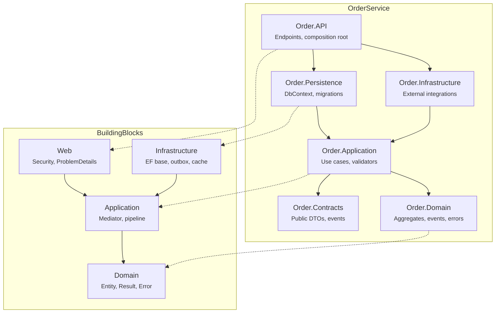
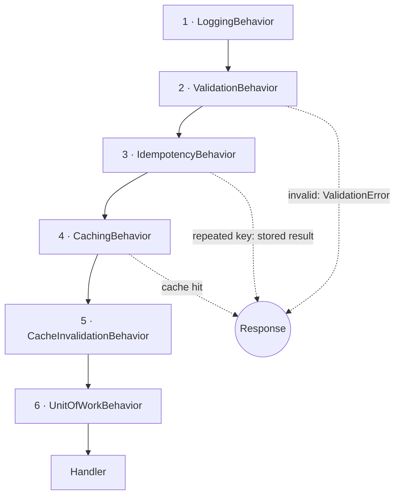
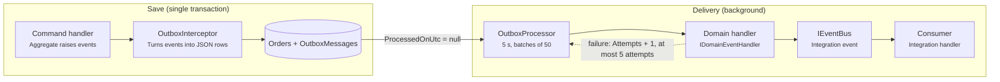

<p align="center"></p>

# Onion / Clean Architecture .NET 10 Microservice Template

[](https://www.nuget.org/packages/OnionArchitecture.Templates)
[](https://www.nuget.org/packages/OnionArchitecture.Templates)
[](https://github.com/gokhanertogan/onion_template/actions/workflows/template-ci.yml)
[](https://dotnet.microsoft.com/)
[](LICENSE)

Onion Template is a `dotnet new` template that generates a production-ready **ASP.NET Core 10 Web API
microservice** built on **Onion / Clean Architecture, DDD and CQRS** with a single command
(`dotnet new onion -n Order`). The default output contains no third-party NuGet packages: the mediator (a MediatR
alternative), validation (a FluentValidation alternative), result pattern, outbox and permission-based authorization
are written inside the template.

```bash
dotnet new install OnionArchitecture.Templates
dotnet new onion -n Order --database sqlite
cd Order && dotnet test
```

After installation the template is also listed in the Visual Studio and JetBrains Rider "New Project" dialogs.

### Why this template?

| | Onion Template | Typical Clean Architecture template |
| --- | --- | --- |
| Third-party packages | None by default | MediatR, FluentValidation, AutoMapper, ... |
| License risk (e.g. MediatR going commercial) | None | Depends on each package |
| Shape | Microservice; add more services with `--service-only` | Usually a single monolith |
| Outbox, idempotency, HybridCache | Built in | Usually not included |
| Security defaults | JWT, permissions, rate limiting, security headers | Varies |
| Architecture rules | Enforced by tests | Convention only |
| Docker, compose, CI, Dependabot | Generated | Varies |

If the template saves you time, please give the repository a ⭐: it is the main way other developers find it.

This document is for developers who use and develop the template. Examples are based on a service generated
with `-n Order`; the template source says `ServiceName` in the same places.

## Contents

1. [Overview](#1-overview)
2. [Installation and usage](#2-installation-and-usage)
3. [Solution structure and layer rules](#3-solution-structure-and-layer-rules)
4. [Domain layer](#4-domain-layer)
5. [Mediator and CQRS](#5-mediator-and-cqrs)
6. [Validation](#6-validation)
7. [Persistence](#7-persistence)
8. [Caching, idempotency and messaging](#8-caching-idempotency-and-messaging)
9. [Web layer and security](#9-web-layer-and-security)
10. [Observability](#10-observability)
11. [Configuration reference](#11-configuration-reference)
12. [Testing strategy](#12-testing-strategy)
13. [Build, Docker and CI/CD](#13-build-docker-and-cicd)
14. [Developer guide](#14-developer-guide)
15. [Known limitations and roadmap](#15-known-limitations-and-roadmap)
16. [Working on the template](#16-working-on-the-template)

---

## 1. Overview

### Design principles

- **Zero third-party dependencies:** only the BCL and Microsoft's own packages. This removes licensing and
  supply-chain risks such as MediatR moving to a commercial license.
- **Dependencies point inwards:** Domain depends on nothing, Application only on Domain. The rule is enforced by
  architecture tests.
- **Secure by default:** every endpoint requires authentication; endpoints that must be open (health, OpenAPI)
  say so explicitly.
- **No exceptions for control flow:** business rule failures are returned as a typed `Error` and converted to
  ProblemDetails in the HTTP layer.
- **Fail fast:** DI registrations (`ValidateOnBuild`) and options (`ValidateOnStart`) are validated when the
  application starts.
- **Warnings are errors:** .NET analyzers run in `Recommended` mode and `TreatWarningsAsErrors` is on.

### Technology stack

| Area | Used | Version |
| --- | --- | --- |
| Runtime | .NET / ASP.NET Core Minimal API | 10.0 |
| ORM | Entity Framework Core | 10.0.13 |
| Database | SQL Server (default), PostgreSQL (Npgsql 10.0.3), SQLite | — |
| Cache | Microsoft.Extensions.Caching.Hybrid | 10.11.0 |
| Authentication | Microsoft.AspNetCore.Authentication.JwtBearer | 10.0.13 |
| API documentation | Microsoft.AspNetCore.OpenApi (OpenAPI 3.1) | 10.0.13 |
| Testing | MSTest + Microsoft.Testing.Platform, Mvc.Testing | 4.5.1 |
| Optional | OpenTelemetry (`--otel`) | 1.20.1 |
| Container | `aspnet:10.0-noble-chiseled-extra` | — |

## 2. Installation and usage

### Installation

```bash
# From NuGet.org
dotnet new install OnionArchitecture.Templates

# From the folder while developing the template (changes apply immediately)
dotnet new install ./templates/onion

# From a locally built package
dotnet pack Onion.Templates.csproj -o artifacts
dotnet new install artifacts/OnionArchitecture.Templates.1.0.0.nupkg
```

### Parameters

| Parameter | Short | Default | Description |
| --- | --- | --- | --- |
| `-n` | — | `Sample` | Service name. Used for projects, namespaces, classes, routes, permissions and cache keys |
| `--database` | `-db` | `sqlserver` | `sqlserver`, `postgres` or `sqlite` |
| `--service-only` | — | `false` | Generates only `src/Services/<Name>Service` and adds its projects to the existing solution |
| `--solution-name` | `-sn` | service name | Name of the solution file (`<name>.slnx`) |
| `--otel` | — | `false` | Adds OpenTelemetry traces, metrics and logs |
| `--no-restore` | — | `false` | Skips the restore after generation |

Every generation picks new HTTP/HTTPS ports (in the 5100–5999 and 7100–7999 ranges) and a new `UserSecretsId`
for the API, so several services can run side by side on the same machine.

### Name transformations

| In the template | Form | Result for `-n Order` | Where |
| --- | --- | --- | --- |
| `ServiceName` | As is | `Order` | Folders, projects, namespaces, classes |
| `servicename` | Lower case | `order` | Docker service and database names |
| `service-name` | Kebab case | `order` | Routes (`/api/v1/orders`), permissions (`orders:write`), cache keys |
| `serviceName` | First letter lower case | `order` | Variable names |
| `SolutionName` | `--solution-name` or the name | `Order` | Solution file, README title |

For multi-word names the kebab form separates the words: `-n OrderManagement` → `/api/v1/order-managements`.

### Scenarios

```bash
dotnet new onion -n Order                                # SQL Server
dotnet new onion -n Order --database postgres --otel     # PostgreSQL + OpenTelemetry
dotnet new onion -n Order --database sqlite              # Quick start without infrastructure
dotnet new onion -n Payment --service-only -o .          # Add a service to an existing solution
./create_project.sh ECommerce Order Basket -- --database postgres
```

In `--service-only` mode the root files (`Directory.*.props`, `global.json`, `.editorconfig`, docker-compose, CI)
and `BuildingBlocks` are not generated; the existing ones are used. Run the command from the solution root with
`-o .`.

`create_project.sh` creates the first service together with the solution and the following ones with
`--service-only`. After each service it also adds the projects with `dotnet sln add`, because the template's
post-action silently continues on failure. It also adds the service's `compose.yaml` to the `include` list of the
root `docker-compose.yml`.

## 3. Solution structure and layer rules

A solution consists of four `BuildingBlocks` projects shared by all services and, per service, six production
projects plus three test projects. Dependencies only flow inwards.



Arrows show the reference direction. The API's direct reference to Application is not drawn.

```
src/
  BuildingBlocks/
    BuildingBlocks.Domain           Entity, AggregateRoot, ValueObject, DomainEvent, Result/Error
    BuildingBlocks.Application      Mediator, CQRS, behaviors, validation, cache/event abstractions
    BuildingBlocks.Infrastructure   EF Core base, interceptors, outbox, HybridCache, event bus
    BuildingBlocks.Web              ServiceDefaults: security, ProblemDetails, rate limiting, health, OpenAPI
  Services/OrderService/
    Order.Core/Order.Domain         Aggregate, strongly typed id, events, errors, repository interface
    Order.Core/Order.Application    Use cases (vertical slices): commands, queries, validators, handlers
    Order.Infrastructure/Order.Infrastructure  External integrations, integration event consumers
    Order.Infrastructure/Order.Persistence     DbContext, EF configurations, repositories, migrations
    Order.Contracts                 Public DTOs and integration events (no dependencies)
    Order.API                       Minimal API endpoints, composition root
    tests/                          Unit, Architecture, Integration
tests/BuildingBlocks.Tests
```

### Project references

| Project | References | Packages |
| --- | --- | --- |
| BuildingBlocks.Domain | — | — |
| BuildingBlocks.Application | BB.Domain | DI and Logging abstractions |
| BuildingBlocks.Infrastructure | BB.Application | EF Core Relational, Caching.Hybrid, Hosting/Options |
| BuildingBlocks.Web | BB.Application | ASP.NET Core, JwtBearer, OpenApi |
| Order.Domain | BB.Domain | — |
| Order.Application | Order.Domain, Order.Contracts, BB.Application | — |
| Order.Persistence | Order.Application, BB.Infrastructure | EF provider, HealthChecks.EF, EF Design |
| Order.Infrastructure | Order.Application, BB.Infrastructure | — |
| Order.Contracts | — | — |
| Order.API | All service projects, BB.Web | EF Design (only for `dotnet ef`) |

### Shared build settings

- **`Directory.Build.props`:** `net10.0`, nullable, `AnalysisMode=Recommended`, `TreatWarningsAsErrors`,
  `EnforceCodeStyleInBuild`, deterministic builds, NuGet audit (`all`, `low`). Projects whose name ends with
  `Tests` automatically become test projects with the MSTest runner.
- **`Directory.Packages.props`:** Central Package Management with transitive pinning. The vulnerable
  `System.Security.Cryptography.Pkcs` brought in by SqlClient is pinned to a patched version here.
- **`global.json`:** SDK 10.0.100 (`latestFeature`) and the `Microsoft.Testing.Platform` test runner.
- **`.editorconfig`:** style rules and analyzer settings. The `Migrations` folder is treated as generated code and
  excluded from analyzers.

### Why are `using` directives inside the namespace?

The service name and the aggregate name are the same (`Order.Domain.Orders.Order`). With `using` directives at the
top of the file, C# name resolution binds `Order` to the root namespace first and the type is not found. Inside
the namespace they are resolved in the inner scope and the type wins. The rule is enforced in `.editorconfig` with
`IDE0065`; for the same reason domain events live in the same namespace as their aggregate.

## 4. Domain layer

The domain is the single owner of business rules and depends on no package. State only changes through aggregate
methods; there are no public setters.

### Building blocks (`BuildingBlocks.Domain`)

| Type | Responsibility |
| --- | --- |
| `Entity<TId>` | Identity-based equality (type + `Id`), `==` / `!=` operators |
| `AggregateRoot<TId>` | Consistency boundary; domain event list (`Raise`, `ClearDomainEvents`) and the `Version` concurrency token |
| `ValueObject` | Component-based equality. Prefer `record` for simple value objects |
| `IAuditable` | `CreatedAtUtc`, `CreatedBy`, `ModifiedAtUtc`, `ModifiedBy`. Filled in by persistence |
| `ISoftDeletable` | `IsDeleted`, `DeletedAtUtc`, `DeletedBy`. Deletes become updates |
| `IVersioned` | Provider-agnostic optimistic concurrency token (`Guid`) |
| `IRepository<TAggregate, TId>` | Aggregate roots only: `GetByIdAsync`, `Add`, `Remove`. No `SaveChanges` |
| `IDomainEvent` / `DomainEvent` | Immutable record carrying `EventId` (GUID v7) and `OccurredOnUtc` |

### Result pattern

Expected failures are returned as values, not exceptions. `Result` and `Result<T>` carry a success flag and an
`Error`; reading `Value` of a failed result throws `InvalidOperationException`.

```csharp
public record Error(string Code, string Description, ErrorType Type);
// ErrorType: Failure, Validation, Problem, NotFound, Conflict, Unauthorized, Forbidden

Result<Guid> ok = id;                                 // T → success (implicit conversion)
Result<Guid> fail = OrderErrors.NotFound(orderId);    // Error → failure (implicit conversion)
return result.Match(Results.Ok, ApiResults.Problem);
```

- `Map`, `Bind`, `Match` and `Result.Combine` provide functional chaining.
- `ValidationError` collects several field errors under a single `Error`.
- With the static abstract member of `IResultFactory<TSelf>`, generic code (such as the validation behavior)
  creates failed results without reflection.
- `Result<T>` round-trips through JSON, which is required to store it in HybridCache's L2 layer.
- Error codes must be stable and machine readable (`Order.NotFound`, `Order.NameAlreadyExists`). Clients branch
  on these codes.

### Sample aggregate

- **Strongly typed id:** `readonly record struct OrderId(Guid Value)`; `New()` creates a time-ordered GUID v7, and
  mixing up ids of different aggregates is caught at compile time.
- **Factory method:** `Order.Create(name, description)` validates the rules, returns `Result<Order>` and raises
  `OrderCreatedDomainEvent`. Constructors are private.
- **Behavior methods:** `Update`, `Archive` (`Conflict` on the second call), `MarkDeleted`; each raises its own
  event.
- **Error catalog:** `OrderErrors` defines every business error in one place with stable codes.
- **Limit constants:** `NameMaxLength = 100`, `DescriptionMaxLength = 1000`. The validator and the EF
  configuration use the same constants, so the values are managed in one place.

## 5. Mediator and CQRS

Instead of MediatR, `BuildingBlocks.Application` contains a dependency-free mediator. The pipeline for each request
type is built and cached on the first call; subsequent calls cost a dictionary lookup and a delegate chain.

### Contracts

| Interface | Returns | Use |
| --- | --- | --- |
| `ICommand` | `Result` | State change without a return value |
| `ICommand<T>` | `Result<T>` | State change that returns a value (e.g. the created id) |
| `IQuery<T>` | `Result<T>` | Side-effect free read |
| `ICommandHandler<,>` / `IQueryHandler<,>` | — | Exactly one handler per request |
| `IPipelineBehavior<TRequest, TResponse>` | — | Cross-cutting behavior; generic constraints decide which requests it applies to |
| `ISender.Send` | `Task<TResponse>` | Scoped; sends the request through the pipeline to its handler |

### Registration and execution

- `AddBuildingBlocksApplication(assembly)` scans the assembly; it registers all handlers as transient, and
  validators and event handlers as scoped.
- If a second handler is found for the same request, registration throws `InvalidOperationException`.
- Behaviors are registered as open generic types. `MediatorRegistry` tries to close them for each request type; a
  behavior whose generic constraints are not satisfied (`MakeGenericType` → `ArgumentException`) is never added to
  that request's pipeline.
- The registry is a singleton per container, so different configurations do not affect each other in tests.

### Pipeline order

Registration order is execution order; the first registered behavior is the outermost.



| # | Behavior | Applies to | Behavior |
| --- | --- | --- | --- |
| 1 | `LoggingBehavior` | All | Activity (span), source-generated logs, duration histogram, failure counter; slow request warning above 500 ms. Payloads are not logged |
| 2 | `ValidationBehavior` | `TResponse : IResultFactory` | Runs all validators; on errors returns `ValidationError` without calling the handler |
| 3 | `IdempotencyBehavior` | `IIdempotentCommand` | Stores the first successful result per user + command + key for 24 hours and replays it |
| 4 | `CachingBehavior` | `ICachedQuery` | Serves successful results from the cache; failures are never cached |
| 5 | `CacheInvalidationBehavior` | `ICacheInvalidator` | Clears the given tags after a successful commit |
| 6 | `UnitOfWorkBehavior` | `IBaseCommand` | Calls `SaveChangesAsync` if the handler succeeded; nothing is written on failure |

Consequences that follow directly from this order:

- An invalid request never reaches the cache or the database.
- An idempotent replay does not trigger the commit or cache invalidation again.
- Cache invalidation runs after the commit, so stale data cannot be cached again.
- Handlers do not call `SaveChanges`; the transaction boundary is the command itself.

### Vertical slice example

Each use case lives in its own folder as request + validator + handler in a single file:

```csharp
public sealed record CreateOrderCommand(string Name, string? Description, Guid? IdempotencyKey = null)
    : ICommand<Guid>, IIdempotentCommand, ICacheInvalidator
{
    public IReadOnlyCollection<string> CacheTagsToInvalidate => OrderCacheKeys.Tags;
}

internal sealed class CreateOrderCommandHandler(IOrderRepository repository)
    : ICommandHandler<CreateOrderCommand, Guid>
{
    public async Task<Result<Guid>> Handle(CreateOrderCommand command, CancellationToken ct)
    {
        if (await repository.NameExistsAsync(command.Name.Trim(), cancellationToken: ct))
            return OrderErrors.NameAlreadyExists(command.Name.Trim());

        var created = Order.Create(command.Name, command.Description);
        if (created.IsFailure) return created.Error;

        repository.Add(created.Value);   // commit: UnitOfWorkBehavior
        return created.Value.Id.Value;
    }
}
```

On the read side, query handlers use `IOrderReadRepository` instead of the aggregate repository. It projects
directly to the response model with `AsNoTracking`.

## 6. Validation

Instead of FluentValidation there is a small, dependency-free fluent validator. Validation happens in two layers:
the application validator checks the shape of the input and returns all errors together, while the domain always
protects its invariants.

### API

```csharp
internal sealed class CreateOrderCommandValidator : AbstractValidator<CreateOrderCommand>
{
    public CreateOrderCommandValidator()
    {
        RuleFor(x => x.Name).NotEmpty().MaximumLength(Order.NameMaxLength);
        RuleFor(x => x.Description).MaximumLength(Order.DescriptionMaxLength);
        RuleFor(x => x.Email).EmailAddress().When(x => x.NotifyCustomer);
        RuleFor(x => x.Address).SetValidator(new AddressValidator());
        RuleForEach(x => x.Lines).NotEmpty();
    }
}
```

| Member | Description |
| --- | --- |
| `RuleFor` / `RuleForEach` | Starts a rule chain for a property or collection element; the property path is read from the expression (`Address.Street`, `Lines[1]`) |
| Built-in rules | `NotNull`, `NotEmpty`, `Empty`, `Equal`, `MaximumLength`, `MinimumLength`, `Length`, `Matches`, `EmailAddress`, `GreaterThan(OrEqualTo)`, `LessThan(OrEqualTo)`, `InclusiveBetween`, `IsInEnum` |
| `Must` / `MustAsync` | Custom rule; an async rule can use scoped services such as repositories |
| `WithMessage` / `WithErrorCode` / `WithName` | Changes the message, code or property name of the last rule; messages can use `{PropertyName}` |
| `When` | Makes the rule conditional |
| `StopOnFirstFailure` | Stops the chain after the first failure (default: all rules run) |
| `SetValidator` | Validates a nested object with its own validator; `null` values are skipped |

A new rule is added by writing an extension method on `IRuleBuilder<T, TProperty>`.

### Error codes and HTTP response

Every error carries the code `"<Property>.<Rule>"` (e.g. `Name.NotEmpty`). The web layer groups codes by property
path and returns an RFC 9457 `ValidationProblem`:

```json
{
  "type": "https://tools.ietf.org/html/rfc9110#section-15.5.1",
  "title": "Validation failed",
  "status": 400,
  "detail": "One or more validation errors occurred.",
  "instance": "POST /api/v1/orders",
  "errors": { "Name": ["'Name' must not be empty."] },
  "code": "Validation.General",
  "traceId": "00-ff9df972...",
  "correlationId": "ff9df972..."
}
```

Validators are registered as scoped and resolved through `IValidator<T>`. A request can have several validators;
their errors are merged.

## 7. Persistence

Each service has its own database and a single DbContext derived from `AppDbContextBase`. Shared behavior such as
auditing, soft delete, concurrency and the outbox is applied in one place as conventions and interceptors; service
code does not repeat it.

### `AppDbContextBase`

- Applies every `IEntityTypeConfiguration` in the derived context's assembly.
- **Conventions:** strings default to 512 characters, decimals to `(18, 4)`. Both can be overridden in
  configuration.
- Adds an `!IsDeleted` global query filter and an `IsDeleted` index to `ISoftDeletable` entities.
- Makes `Version` the concurrency token of `IVersioned` entities.
- Adds the `OutboxMessages` table to the model.
- Implements `IUnitOfWork`. Converts `DbUpdateConcurrencyException` to the application layer's
  `ConcurrencyException`, which the web layer returns as 409.

### Interceptors

Interceptors run in order, and the order matters.

| # | Interceptor | What it does |
| --- | --- | --- |
| 1 | `SoftDeleteInterceptor` | Turns a `Deleted` `ISoftDeletable` entity into `Modified`; fills `IsDeleted`, `DeletedAtUtc`, `DeletedBy` |
| 2 | `AuditingInterceptor` | Fills `Created*` on insert and `Modified*` on update using `TimeProvider` and `ICurrentUser`; prevents `Created*` from changing |
| 3 | `VersioningInterceptor` | Assigns a new GUID v7 to `Version` on every insert and update. Needs no `rowversion` or `xmin`, works on every provider |
| 4 | `OutboxInterceptor` | Writes the aggregates' domain events as JSON to `OutboxMessage` rows and clears the list |

Soft delete must come first, so that once a delete has become an update the audit and version fields are updated
as well.

### Transactional outbox

Domain events are written to the outbox table in the same transaction as the `SaveChanges` that changes the state.
This rules out "the data was saved but the event was lost".



- `OutboxProcessor<TDbContext>` is a `BackgroundService`. Using a `PeriodicTimer` (5 s by default, 1 s in
  development) it reads unprocessed messages in `Id` order in batches of 50; GUID v7 values are time ordered. When a
  batch is full it continues without waiting.
- Each message is dispatched through `IDomainEventDispatcher` to all matching `IDomainEventHandler<T>`s. On success
  `ProcessedOnUtc` is set, on failure `Error` and `Attempts` are updated. After 5 attempts the message is no longer
  picked up (poison message).
- **Security:** the type name is checked before deserializing. Only concrete types implementing `IDomainEvent` are
  accepted, so a tampered row cannot create arbitrary types.
- **Delivery guarantee:** at-least-once. Event handlers must be idempotent.

### Repositories

- The `Repository<TAggregate, TId>` base provides `FindAsync`, `Add` and `Remove`, and does not call `SaveChanges`.
  A service repository only adds aggregate-specific queries (`NameExistsAsync`).
- The read repository (`IOrderReadRepository`) uses `AsNoTracking` and pages with `ToPagedListAsync`. The helper
  runs the count query first and the page query second, and skips the second query when the count is zero.
- Paging is 1-based. `PageRequest` clamps values to safe limits: page at least 1, page size between 1 and 100.

### Database providers

| Option | Package | Connection settings |
| --- | --- | --- |
| `sqlserver` | Microsoft.EntityFrameworkCore.SqlServer | `EnableRetryOnFailure` |
| `postgres` | Npgsql.EntityFrameworkCore.PostgreSQL | `EnableRetryOnFailure` |
| `sqlite` | Microsoft.EntityFrameworkCore.Sqlite | — |

`EnableDetailedErrors` is on in Development. The connection string is read from `ConnectionStrings:<Service>Db`;
if it is missing, the application stops with a clear error.

### Migrations

```bash
dotnet tool restore
dotnet ef migrations add Initial \
  --project src/Services/OrderService/Order.Infrastructure/Order.Persistence \
  --startup-project src/Services/OrderService/Order.API --output-dir Migrations
```

- `DatabaseInitializer` applies migrations when `Database:ApplyMigrationsOnStartup=true` (Development). If there
  are no migrations, it creates the schema with `EnsureCreated` and logs a warning.
- In production, migrations are applied in the pipeline with an idempotent bundle:
  `dotnet ef migrations bundle --idempotent --self-contained`.

## 8. Caching, idempotency and messaging

Caching and idempotency use the same `ICacheService` abstraction, implemented with HybridCache: L1 memory, an
optional L2 distributed cache, stampede protection and tag-based invalidation.

### Query cache

```csharp
public sealed record GetOrderByIdQuery(Guid Id) : ICachedQuery<OrderResponse>
{
    public string CacheKey => OrderCacheKeys.ById(Id);                    // "orders:{id:N}"
    public IReadOnlyCollection<string> CacheTags => OrderCacheKeys.Tags;  // ["orders"]
    public TimeSpan? Expiration => OrderCacheKeys.Expiration;             // 5 min
}
```

- Concurrent requests for the same key are coalesced into a single handler execution (stampede protection).
- Failed results are not cached: they are carried out of the cache factory with a dedicated exception and returned
  as is.
- All entries are tagged with the aggregate tag. Every command implementing `ICacheInvalidator` clears this tag
  after a successful commit; single entries and every list page are invalidated together.
- **List key:** the search term is upper-cased and the page and page size are appended. The validator limits the
  search term to 100 characters, so the key never exceeds the 512-character limit.
- **HybridCache settings:** 5 min default expiration, at most 1 MB payload, at most 512-character keys.

### Distributed L2 cache

If an `IDistributedCache` is registered **before** `AddBuildingBlocksInfrastructure()`, HybridCache automatically
uses it as L2. The Redis package is third-party, so it is not part of the template. A distributed cache is required
for consistent idempotency across multiple instances.

### Idempotency

1. The client sends an `Idempotency-Key: <guid>` header; the endpoint puts it into the command's `IdempotencyKey`.
2. `IdempotencyBehavior` builds the key as `idempotency:{command type}:{user}:{key}`.
3. The first successful result is stored for 24 hours. Repeats with the same key get the same result without
   running the handler, and the replay is logged.
4. Concurrent duplicates are coalesced into a single execution by stampede protection. Failed results are not
   stored, so the client can fix the request and retry with the same key.

Because the key contains the user id, a user cannot replay another user's result.

### Domain events and integration events

| | Domain event | Integration event |
| --- | --- | --- |
| Defined in | `Order.Domain` (`OrderCreatedDomainEvent`) | `Order.Contracts` (`OrderCreatedIntegrationEvent`) |
| Scope | Inside the service | Between services (public contract) |
| Transport | Outbox → `IDomainEventDispatcher` | `IEventBus` |
| Handler | `IDomainEventHandler<T>` (Application) | `IIntegrationEventHandler<T>` (Infrastructure) |
| Delivery | At-least-once | In-process with the default bus |

In the generated sample the flow is: the domain event is delivered from the outbox, `OrderCreatedDomainEventHandler`
publishes the integration event to `IEventBus`, and `OrderCreatedIntegrationEventHandler` in Infrastructure consumes
it.

The default `InMemoryEventBus` is a `Channel` with a capacity of 10,000 and a `BackgroundService` that reads it;
each message is handled in its own DI scope. It suits a single process (modular monolith, development). For real
delivery between services, `IEventBus` is replaced with a broker implementation (RabbitMQ, Kafka, Azure Service
Bus); the application layer does not change.

## 9. Web layer and security

`BuildingBlocks.Web` gives every service the same production defaults with three calls, so `Program.cs` stays
under 20 lines:

```csharp
var builder = WebApplication.CreateBuilder(args);
builder.AddServiceDefaults();
builder.Services
    .AddOrderApplication()
    .AddOrderInfrastructure(builder.Configuration)
    .AddOrderPersistence(builder.Configuration)
    .AddEndpoints(typeof(Program).Assembly);

var app = builder.Build();
app.UseServiceDefaults();
app.MapDefaultEndpoints();
app.MapEndpoints(app.MapGroup("api/v1"));
await app.RunAsync();
```

### Middleware order (`UseServiceDefaults`)

1. `UseExceptionHandler`: converts unhandled exceptions to ProblemDetails.
2. `UseStatusCodePages`: adds a ProblemDetails body to bodiless 401/403/404 responses.
3. `UseHsts`: outside Development.
4. `UseHttpsRedirection`.
5. `SecurityHeadersMiddleware`.
6. `CorrelationIdMiddleware`.
7. `UseCors`.
8. `UseAuthentication`.
9. `UseRateLimiter`: comes after authentication so limits can be applied per user.
10. `UseAuthorization`.
11. `UseRequestTimeouts`.

### Authentication and authorization

- **JWT bearer:** settings are bound from the `Authentication:Schemes:Bearer` section (`Authority`,
  `ValidAudiences`, `ValidIssuer`). With `MapInboundClaims = false` the `sub` and `scope` claims are kept as is.
  Clock skew tolerance is 30 s.
- **Secure by default:** the fallback policy requires an authenticated user. Health and OpenAPI endpoints are
  explicitly marked `AllowAnonymous`.
- **Permission-based authorization:** `RequirePermission("orders:write")`. A permission is granted through the
  `permission`/`permissions` claim or the space-separated `scope`/`scp` claim; this works with any OIDC provider
  such as Entra ID, Keycloak or Auth0.
- **`ICurrentUser`:** reads the user id from the `sub` claim. Returns `null` in background work (outbox).
- **Development:** `dotnet user-jwts create --scope "orders:read" --scope "orders:write"` writes the signing key to
  user secrets; no extra configuration is needed. The token's audience is the service URL, so a token for one
  service gets 401 from another.

| Situation | Response |
| --- | --- |
| No token or invalid token | 401 |
| Valid token, missing permission | 403 |
| Rate limit exceeded | 429 + `Retry-After` |
| Request took longer than 30 s | 504 |

### Attack surface reduction

| Measure | Value |
| --- | --- |
| Security headers | `X-Content-Type-Options: nosniff`, `X-Frame-Options: DENY`, `Content-Security-Policy: default-src 'none'; frame-ancestors 'none'`, `Referrer-Policy: no-referrer`, `Permissions-Policy`, `Cross-Origin-Opener-Policy: same-origin`, default `Cache-Control: no-store` |
| Kestrel | `Server` header off, at most 10 MB body, at most 32 KB headers |
| CORS | Allow-list; an empty list means no cross-origin access. Methods and headers are explicitly limited |
| Rate limiting | Fixed window per user (`sub`) or client IP; 100 per minute by default, no queue |
| Correlation id | Only `[A-Za-z0-9_-]` up to 64 characters is accepted; prevents header and log injection |
| Error details | Hidden in 5xx responses; exception messages are only shown in Development |
| DI validation | `ValidateScopes` and `ValidateOnBuild` on in every environment |

### Error handling

`ApiResults.Problem(Error)` maps the `ErrorType` to an HTTP status. The response is RFC 9457 formatted and
carries `code`, `traceId`, `correlationId` and `instance` (e.g. `POST /api/v1/orders`).

| ErrorType | HTTP |
| --- | --- |
| Validation, Problem | 400 (Validation: per-field `errors`) |
| Unauthorized | 401 |
| Forbidden | 403 |
| NotFound | 404 |
| Conflict | 409 |
| Failure | 500 (details hidden) |

`GlobalExceptionHandler` catches unexpected errors: `ConcurrencyException` maps to 409, `BadHttpRequestException`
to its own status, client cancellation to 499 and everything else to 500.

### Endpoints

Each endpoint is an `internal sealed` class implementing `IEndpoint`, added automatically under the `api/v1` group
by assembly scanning. The generated service exposes:

| Method | Path | Permission | Success |
| --- | --- | --- | --- |
| POST | `/api/v1/orders` | `orders:write` | 201 + `Location` |
| GET | `/api/v1/orders?search=&page=&pageSize=` | `orders:read` | 200, paged |
| GET | `/api/v1/orders/{id}` | `orders:read` | 200 |
| PUT | `/api/v1/orders/{id}` | `orders:write` | 204 |
| POST | `/api/v1/orders/{id}/archive` | `orders:write` | 204 |
| DELETE | `/api/v1/orders/{id}` | `orders:write` | 204 (soft delete) |
| GET | `/health/live`, `/health/ready` | anonymous | 200 / 503 |
| GET | `/openapi/v1.json` | anonymous, Development | 200 |

Health endpoints are excluded from rate limiting and return short JSON without exception details. `live` only
checks the process; `ready` checks the `ready`-tagged checks such as the database. The OpenAPI document includes
the Bearer security scheme; in other environments it is enabled with `OpenApi:Enabled`.

## 10. Observability

Logs, traces and metrics are built on `System.Diagnostics`, so no packages are required. Services generated with
`--otel` export them over OTLP.

### Logging

- **Format:** JSON console formatter with UTC timestamps and scopes in production; single-line simple formatter in
  Development.
- **Performance:** all logs are generated with the `[LoggerMessage]` source generator; there is no boxing or message
  parsing at runtime. EventId ranges: 1000 behaviors, 2000 outbox and persistence, 3000 web, 5000 service.
- **Scopes:** `CorrelationId` is added to logs for every HTTP request and `RequestName` for every mediator request.
- **Privacy:** request and response payloads are not logged.
- **Noise:** EF SQL logs are at `Warning` by default. They can be raised to `Information` in Development, but the
  outbox poller then logs a query every second.

### Correlation id

`X-Correlation-ID` is used if it is valid in the request; otherwise the W3C trace id is used. The value is written
to `HttpContext.TraceIdentifier`, the current span, the log scope, the response header and ProblemDetails.

### Tracing and metrics

| Name | Kind | Tags |
| --- | --- | --- |
| `BuildingBlocks.Application` | ActivitySource: one span per request | `app.request.name`, `app.request.kind`, `app.error.code` |
| `application.request.duration` | Histogram (ms) | `request`, `kind` (command/query), `outcome` (success/failure/exception) |
| `application.request.failures` | Counter | `request`, `error.type` |

### OpenTelemetry (`--otel`)

- **Traces:** ASP.NET Core (excluding `/health`), HttpClient, `BuildingBlocks.Application` and sources named after
  the application.
- **Metrics:** ASP.NET Core, HttpClient, runtime and the `BuildingBlocks.Application` meter.
- **Logs:** OpenTelemetry log provider with formatted messages and scopes.
- **Export:** sent over OTLP when `OTEL_EXPORTER_OTLP_ENDPOINT` is set. Works with Jaeger, Tempo, Grafana, Seq, the
  Aspire dashboard and Azure Monitor.

## 11. Configuration reference

All settings are read from `appsettings.json` and environment variables. Environment variables use `__` instead of
`:` (`ConnectionStrings__OrderDb`). Secrets are never written to `appsettings.json`.

| Key | Default | Development | Description |
| --- | --- | --- | --- |
| `ConnectionStrings:<Service>Db` | none (required) | local docker | Database connection |
| `Authentication:Schemes:Bearer:Authority` | none | `user-jwts` | OIDC provider |
| `Authentication:Schemes:Bearer:ValidAudiences` | `["<service>-api"]` | localhost URLs | Accepted audiences |
| `Cors:AllowedOrigins` | `[]` | `http://localhost:3000` | Browser origin allow-list |
| `RateLimiting:Enabled` | `true` | — | Global limiter |
| `RateLimiting:PermitLimit` | `100` | — | Permits per window and caller (1–1,000,000) |
| `RateLimiting:Window` | `00:01:00` | — | Window length (1 s–1 h) |
| `Outbox:Enabled` | `true` | — | Outbox processor |
| `Outbox:PollingInterval` | `00:00:05` | `00:00:01` | Polling interval |
| `Outbox:BatchSize` | `50` | — | Batch size (1–1000) |
| `Outbox:MaxAttempts` | `5` | — | Poison message threshold |
| `Database:ApplyMigrationsOnStartup` | `false` | `true` | Apply migrations on startup |
| `OpenApi:Enabled` | `false` | `true` | `/openapi/v1.json` |
| `AllowedHosts` | `*` | — | Should be restricted to the real host names in production |
| `OTEL_EXPORTER_OTLP_ENDPOINT` | none | — | OTLP target with `--otel` |
| `ASPNETCORE_FORWARDEDHEADERS_ENABLED` | none | — | `true` behind a reverse proxy |

The `RateLimiting` and `Outbox` options are validated with DataAnnotations at startup; an invalid value prevents
the application from starting. Settings are bound lazily through `IOptions`, so they can be safely overridden in
tests and different environments.

## 12. Testing strategy

A single-service solution comes with 54 tests; each additional service adds 28. All tests run on MSTest 4 and
Microsoft.Testing.Platform without a mocking library; fakes are written by hand.

| Project | Tests | Coverage |
| --- | --- | --- |
| `BuildingBlocks.Tests` | 26 | Pipeline order, skipping behaviors whose constraints do not match, validation short-circuit, caching only successes, cache invalidation only after success, idempotency (replay per user + key, failures not stored, concurrent duplicates coalesced), duplicate handler detection, validator rules, Result and JSON round-trip. Persistence tests run the real EF Core pipeline (interceptors, query filters, concurrency tokens) on in-memory SQLite: soft delete, auditing, concurrent updates, outbox rows written in the same transaction, and the outbox processor's retry, `MaxAttempts` and type allowlist behavior |
| `<Service>.UnitTests` | 9 | Aggregate invariants and events, handlers (with `FakeOrderRepository`), validators |
| `<Service>.ArchitectureTests` | 9 | Layer dependencies and conventions (via reflection) |
| `<Service>.IntegrationTests` | 10 | The real HTTP pipeline end to end |

### Architecture rules

- **Domain:** must not depend on Application, Infrastructure, Persistence, API, Contracts, EF Core, ASP.NET Core or
  `Microsoft.Extensions` packages.
- **Application:** must not depend on Infrastructure, Persistence, API, EF Core or ASP.NET Core.
- **Persistence and Infrastructure:** must not depend on the API; Persistence must not depend on ASP.NET Core
  either.
- **Contracts:** must not depend on any assembly outside the framework.
- **Handlers, validators and endpoints:** must be `internal sealed`.
- **Domain events:** must be `sealed record`.
- **Aggregates:** must be `sealed` and have no public setters or public constructors.
- Every rule must match at least one type, so a broken selector cannot silently disable a rule.

### Integration tests

`<Service>ApiFactory` boots the real API in memory with `WebApplicationFactory<Program>`:

- **Database:** a temporary SQLite file is used regardless of the selected provider. The DbContext registration
  (`DbContextOptions` and `IDbContextOptionsConfiguration`) is replaced, the interceptors are kept and the schema is
  created with `EnsureCreated`.
- **Identity:** JWTs signed with a symmetric key created in the test are used. `CreateClientWithPermissions(...)`
  returns a client with the requested permissions.
- **Environment:** the `Testing` environment uses a 200 ms outbox interval and a high rate limit. A single host is
  shared by the whole assembly; tests are isolated by unique data.

Covered scenarios:

- Create → read → update (verifying the cache is cleared) → delete → 404.
- Search and paging.
- Validation ProblemDetails, 409 conflict and error code.
- A single execution for the same `Idempotency-Key`.
- Processing of the outbox message.
- 401, 403, security headers, correlation id and the absence of the `Server` header.
- Readiness checking the database.

SQLite does not test provider-specific behavior (collation, locking, SQL Server and Postgres types). A separate
suite against a real database in CI is recommended for those.

```bash
dotnet test                                   # all tests
dotnet test --project src/Services/OrderService/tests/Order.UnitTests
```

## 13. Build, Docker and CI/CD

Each service has its own Dockerfile; the build context is the solution root. CI builds, tests and produces the
images on every push.

### Docker image

- **Build:** two stages. Restore and publish run on `sdk:10.0`; the NuGet cache is shared through a BuildKit mount
  with `sharing=locked`, so parallel image builds do not collide.
- **Runtime:** `aspnet:10.0-noble-chiseled-extra`. No shell or package manager; runs as the non-root `app` user by
  default. The `-extra` variant includes the ICU and tzdata that database drivers need.
- **Port:** the application listens on HTTP 8080; TLS terminates at the reverse proxy or ingress.
- **SQLite variant:** a `/data` directory owned by the `app` user is created in the image.

```bash
docker build -f src/Services/OrderService/Dockerfile -t order-api .
docker compose up --build     # APIs + database
```

Compose has two layers:

- `src/Services/<Name>Service/compose.yaml`: the service's API. Every service brings its own file, also when
  generated with `--service-only`.
- The root `docker-compose.yml`: collects the service files with `include` and defines **one shared database
  server** (`db`) with a health check. Each service uses its own database on that server and creates it on
  startup, so the `localhost:5432` / `1433` ports do not collide between services and `appsettings.Development.json`
  works as is. The SQLite variant has no server; each service uses its own volume.

The `dotnet user-jwts` keys are mounted read-only from the user secrets folder into the container, so local tokens
are valid in the container too.

### CI (`.github/workflows/ci.yml`)

1. The SDK is installed from `global.json`.
2. `dotnet restore`.
3. Vulnerable package check: `dotnet list package --vulnerable --include-transitive`; any finding fails the build.
4. `dotnet format whitespace --verify-no-changes`. Code style (IDE rules) is already enforced by the build;
   `dotnet format style` is not used because it also checks `using` order, and the template's order depends on the
   service name (names such as `Basket` or `Catalog` sort before `Microsoft.*`).
5. Release build (warnings are errors).
6. `dotnet test`.
7. Compose validation with `docker compose config` and an image build for every service found by
   `src/Services/*/Dockerfile`. No CI change is needed for a new service.

The workflow only has the `contents: read` permission. Older runs for the same branch are cancelled. Actions are
pinned by commit SHA instead of a tag (with the version as a comment), so a tag moved to another commit later does
not affect the pipeline.

### Dependency updates (`.github/dependabot.yml`)

Every week Dependabot opens PRs for NuGet packages (`Directory.Packages.props`, `dotnet-tools.json`), GitHub
Actions and the services' Docker base images. Minor and patch updates are grouped into one PR; major updates come
as separate PRs. SHA-pinned actions are kept up to date this way too.

### Production readiness checklist

- [ ] `AllowedHosts`, `Cors:AllowedOrigins`, JWT `Authority` and `ValidAudiences` are configured
- [ ] Connection strings and secrets come from environment variables or a vault
- [ ] A migration exists and is applied in the pipeline with a migration bundle
- [ ] `Database:ApplyMigrationsOnStartup` and `OpenApi:Enabled` are off
- [ ] With multiple instances, a distributed L2 cache is registered (required for idempotency)
- [ ] A broker-based `IEventBus` implementation exists for events between services
- [ ] The outbox processor runs on a single instance, or a provider-specific row lock has been added
- [ ] `ASPNETCORE_FORWARDEDHEADERS_ENABLED=true` behind a reverse proxy
- [ ] The liveness probe is `/health/live` and the readiness probe is `/health/ready`
- [ ] Rate limits are tuned to real traffic

## 14. Developer guide

A new feature is added in four layers, from the inside out. Architecture tests catch a dependency added in the
wrong direction.

### New use case (example: confirming an order)

1. **Domain:** add the `Confirm()` method, its invariant check and `OrderConfirmedDomainEvent` to the aggregate,
   and the new error to `OrderErrors`. Add a value to `OrderStatus` if needed.
2. **Application:** in `Orders/Confirm/ConfirmOrderCommand.cs`, write `ConfirmOrderCommand : ICommand,
   ICacheInvalidator` with its validator and handler as `internal sealed`. The handler does not call `SaveChanges`.
3. **API:** implement `IEndpoint` in `Endpoints/Orders/ConfirmOrder.cs`; add
   `RequirePermission(OrderPermissions.Write)` and return `result.Match(Results.NoContent, ApiResults.Problem)`. The
   endpoint is discovered automatically.
4. **Persistence:** if the schema changed, update the EF configuration and run
   `dotnet ef migrations add ConfirmOrder`.
5. **Tests:** add a unit test for the aggregate, a handler test with a hand-written fake and an integration test for
   the endpoint.
6. If the event needs a reaction, write an `IDomainEventHandler<OrderConfirmedDomainEvent>` in Application. The
   handler must be idempotent.

### New read endpoint

Add a method to `IOrderReadRepository` that projects with `AsNoTracking`. Define the query as `ICachedQuery<T>`,
put its key in `OrderCacheKeys` and use the aggregate tag. Existing commands that clear this tag automatically
invalidate the new cache entry as well.

### New service

```bash
dotnet new onion -n Payment --service-only -o .
```

Then:

- Add `src/Services/PaymentService/compose.yaml` to the `include` list in `docker-compose.yml`
  (`create_project.sh` does this for you). CI builds the new service's image automatically.
- If the new service uses a different database provider, add its package version to `Directory.Packages.props` and
  its database server to `docker-compose.yml`.

### New cross-cutting behavior

Write an open generic class implementing `IPipelineBehavior<TRequest, TResponse>`. Use generic constraints to
decide which requests it applies to (e.g. `where TRequest : IAuditedCommand`) and register it with
`AddOpenBehavior` in `AddBuildingBlocksApplication` at the right position.

### New validation rule

```csharp
public static IRuleBuilder<T, string?> Iban<T>(this IRuleBuilder<T, string?> rule) =>
    rule.Must((_, v) => v is null || IbanChecker.IsValid(v), "'{PropertyName}' is not a valid IBAN.", "Iban");
```

## 15. Known limitations and roadmap

The limitations below are deliberate choices; each leaves a clear extension point.

| Topic | Current state | Suggested extension |
| --- | --- | --- |
| Outbox scaling | Multiple instances may process the same message | `FOR UPDATE SKIP LOCKED` (Postgres) / `READPAST` (SQL Server) or a single worker |
| Event bus | In-process `Channel` | RabbitMQ, Kafka or Azure Service Bus implementation; inbox table on the consumer side |
| Distributed cache | L1 memory only | Redis `IDistributedCache` (third-party) |
| Uniqueness | Application-level name check | Provider-specific filtered unique index |
| Search | `UPPER(...) LIKE`, does not use an index | Normalized column or full-text search |
| API versioning | Route group (`/api/v1`) | Separate group for a new version; `Asp.Versioning` external package |
| Integration tests | SQLite | Additional suite against a real database in CI |
| Resilience | EF retry only | `Microsoft.Extensions.Http.Resilience` for outgoing HTTP (depends on Polly) |
| Native AOT | Not supported (reflection-based scanning) | Handler and endpoint registration with a source generator |
| Docker Compose | `--service-only` alone does not update the `include` list (`create_project.sh` does) | One line added by hand; a template post-action in the future |

## 16. Working on the template

### Repository layout

```text
onion_template/
├── .github/
│   ├── dependabot.yml       # This repository's actions and the template's package/image versions
│   └── workflows/
│       ├── template-ci.yml  # The template's own CI: pack + all variants + multiple services
│       └── release.yml      # Publishes to NuGet.org and creates a GitHub release on v* tags
├── assets/                  # Package icon and the short README shown on NuGet.org
├── templates/onion/         # The template itself: the exact source of the generated solution
│   ├── .template.config/    # dotnet new, Visual Studio (ide.host.json) and CLI host definitions
│   └── .github/             # CI and Dependabot of the generated solution (not run in this repository)
├── Onion.Templates.csproj   # Packs templates/** into a NuGet template package
├── create_project.sh        # Creates a solution with several services in one command
└── README.md
```

Everything that belongs to the template lives under `templates/onion`; the root only holds packaging, CI and the
helper script.

### Build and verify

The `templates/onion` folder is a solution that can be built and tested directly:

```bash
cd templates/onion
dotnet build SolutionName.slnx && dotnet test --solution SolutionName.slnx
```

After a change, generate and verify different variants:

```bash
dotnet new onion -n Order -o /tmp/Order && (cd /tmp/Order && dotnet test)
dotnet new onion -n Basket --database postgres --otel -o /tmp/Basket && (cd /tmp/Basket && dotnet test)
```

### CI (`.github/workflows/template-ci.yml`)

On every push and PR the template is packed, and the outputs generated from the package are verified with the
generated solution's own checks:

- **Variant matrix:** `--database` (`sqlserver`, `postgres`, `sqlite`) × `--otel`, 6 jobs in total. The service name
  is `Basket`; it sorts before `BuildingBlocks` and `Microsoft`, which catches name-dependent issues. Each job runs
  the format check, a Release build, the tests and `docker compose config`.
- **Multiple services:** `create_project.sh ECommerce Order Basket -- --database postgres`; build, tests, a check
  that compose contains two APIs, and a Docker image for each service.

### Releasing (`.github/workflows/release.yml`)

```bash
git tag -a v1.1.0 -m "OnionArchitecture.Templates 1.1.0" && git push origin v1.1.0
```

A tag push first runs `template-ci`; if it passes, the package is built with the tag's version (without the `v`) and
pushed to NuGet.org, then a GitHub release with generated notes and the `.nupkg` is created. The only setting required is the `NUGET_API_KEY` secret of the `nuget` environment; adding a
required reviewer to that environment in GitHub makes every release wait for manual approval. Pushing the same
version again is skipped with `--skip-duplicate`. The `1.0.0` in `Onion.Templates.csproj` is only the default for
local packs.
